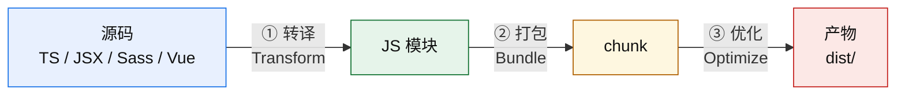
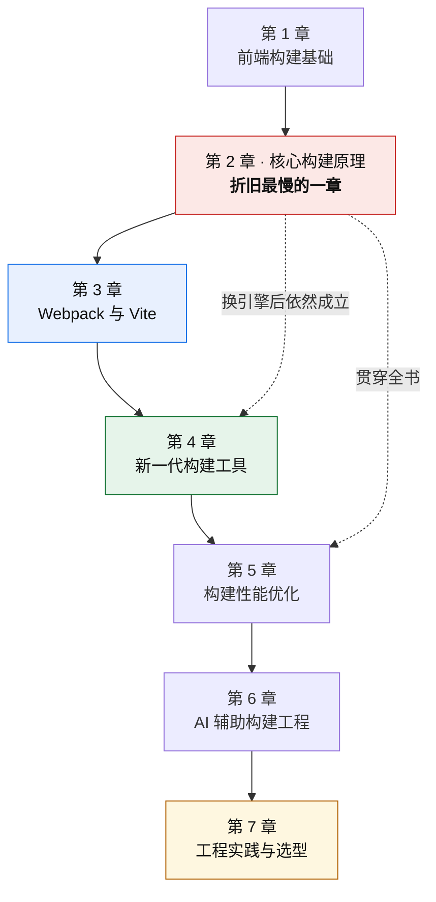

# 第 1 章 · 前端构建基础

> **本章定位**：为后面所有章节铺地基。1.1 与 1.3 属于【补充背景】——课程未设专门小节讲这两块，为让知识链完整，由编纂者补写通识内容，**不带有课程批改与确认记录**。1.4 是课程中真正讲过的一节（模块 1 第 8 节），1.2 与 1.5 是全书导引。

---

## 1.1 从无模块到 ESM：浏览器加载代码的三次进化【补充背景】

要理解构建工具为什么存在，得先知道浏览器手上的牌有多难打。

**第一阶段：没有模块。** 早期页面把 `<script>` 一个接一个贴上，所有变量挤在全局作用域里。需要"模块"就只能靠 IIFE 和命名空间对象自己模拟。**加载顺序靠人肉维护，依赖关系不在代码里。**

**第二阶段：模块出现了，但浏览器不认。** CommonJS（Node 生态）用 `require`，AMD 用 `define`，本质上都是**运行时**解析依赖 —— 浏览器要先拿到文件、执行到那一行，才知道还要再下载什么。这导致两个固有问题：**请求是串行的、依赖图是运行时才建出来的。**

**第三阶段：ESM 成为标准。** `import` / `export` 是**静态语法**——浏览器在解析阶段就能扫出依赖，不必执行代码。这是决定性的变化：**依赖图第一次可以在"不运行代码"的前提下被算出来。**

> 正是这条性质，支撑了后面几乎所有优化：Tree Shaking 需要静态分析才能标记未使用的导出；Vite 的按需转换需要知道模块之间的引用关系；代码分割需要知道哪里是图的断点。

**但 ESM 也不解决全部问题**，它留下了三件事给人：

| 问题 | 为什么 ESM 解决不了 |
|---|---|
| 老语法 / 非 JS 语言 | 浏览器只认 JS。TS、JSX、Sass、Vue SFC 都需要**先转成 JS** |
| 兼容旧浏览器 | 原生 ESM 是较新的能力，老浏览器不支持 |
| 请求数量 | 一个依赖几百个内部模块的库（如 `lodash-es`），按原生 ESM 加载就是几百个请求 |

这三件事合起来，就是构建工具的生存空间。

---

## 1.2 构建工具究竟做了什么【导引】

剥掉所有配置项和插件名，构建工具只做三件事：

| 环节 | 做什么 | 常见执行者 |
|---|---|---|
| ① 转译 | 把浏览器不认的东西变成浏览器认的 | Babel / tsc → SWC / esbuild |
| ② 打包 | 沿着依赖图，把散落的模块合成若干 chunk | Webpack / Rollup / Rspack / Rolldown |
| ③ 优化 | 压缩、混淆、摇树、分割、打 hash | Terser / SWC minify + 打包器自身 |

**关键认知**：这三件事**不是绑在一起的**。它们可以分别替换 —— 这个认知是第 4 章理解"原来可以只换一层"的前提。

**为什么值得强调**：大多数人对构建工具的印象是"Webpack 或者 Vite"，把它们当成两个不可分割的整体。实际上它们是**一条流水线的不同段位**，而这条流水线的每一段，现在都有原生实现可以替换。

---

## 1.3 依赖管理与 npm 的角色【补充背景】

构建工具处理的"依赖"，绝大多数来自 npm。

| 概念 | 作用 | 与构建的关系 |
|---|---|---|
| `package.json` | 声明依赖版本范围、脚本、以及 `sideEffects` / `main` / `module` / `exports` 等字段 | **构建工具会读它**：`sideEffects` 决定 Tree Shaking 的激进度；`exports` 决定 `resolve` 能解析到什么 |
| `package-lock.json` / `pnpm-lock.yaml` | 锁定实际安装的精确版本 | 影响缓存失效判断（Vite 依赖预构建的缓存键包含 lockfile） |
| `node_modules` | 实际安装位置 | `resolve` 的默认查找路径 |

**三个字段值得单独记住**（后文都会用到）：

- **`sideEffects`** —— 告诉打包器"这个模块有没有副作用"。写 `false` 表示可以安全跳过未被引用的模块。**它是库作者写的，不是消费方能改的。**
- **`exports`** —— 决定哪些路径可以被 import、以及在不同环境（`import` / `require` / `browser`）下分别指向哪个文件。**配错会导致"解析得到文件 A，运行时期待文件 B"。**
- **`main` / `module` / `types`** —— 三个入口字段，分别给 CJS 消费者、ESM 消费者、TypeScript 消费者。**发布组件库时必须手动对齐**（见第 7 章 §7.5）。

**版本范围与它的代价**：`^1.2.3` 允许自动升到 `1.x` 的最新版。好处是能吃到修 bug，代价是**同一份 lockfile 之外的两台机器可能装到不同版本** → 构建结果不一致。这是"本地能跑、CI 挂了"的一类常见来源。

---

## 1.4 开发构建与生产构建：两个目标，两套策略【已学】

这是课程中讲过的一节（模块 1 第 8 节），也是理解后面所有"为什么 dev 一套、build 另一套"的总开关。

**核心事实：开发和生产的目标是冲突的。**

| 维度 | 开发模式 | 生产模式 |
|---|---|---|
| 目标 | 构建快、反馈快 | 产物小、加载快 |
| 压缩混淆 | 不做 | Terser / SWC minify |
| Tree Shaking | 不启用 | 启用 |
| Source Map | `eval-cheap-*` 快而糙 | `hidden` 慢而准 |
| 代码分割 | 不抽公共包 | `splitChunks` / `manualChunks` |
| HMR | 启用 | 无 |
| `NODE_ENV` | `development` | `production` |

**开发模式愿意牺牲产物质量换速度** —— 所以不压缩、不抽公共包、source map 只求"能定位到行"。
**生产模式愿意牺牲构建时长换产物质量** —— 所以压缩、摇树、分割、算 hash 全上。

**这条冲突解释了很多"奇怪"现象**：

- 为什么本地跑得好好的，build 之后行为变了？→ 两套模式下**代码走了不同的优化路径**（第 4 章 §4.4 的 dev/prod parity 问题就是它的直接后果）。
- 为什么 `console.log` 生产环境还在？→ **`mode` 不负责删 console**，要自己配 `terserOptions.compress.drop_console`。
- 为什么开发时不报类型错误？→ 转译器**只剥离类型标注，不做类型检查**（第 4 章 §4.2）。

**两个模式之间共享的机制**，只有一个，但它极其重要 ——**构建期字面量替换**。`process.env.NODE_ENV` 不是运行时的环境变量，而是被构建工具在**编译期整体替换成字符串**，然后在生产模式下由压缩器把恒假分支**物理删除**。详细机制在 §2.8。

---

## 1.5 全书知识地图

**读这张图的方式**：

- 第 2 章是**唯一不会被淘汰的部分**。依赖图、Loader/Plugin 分工、Tree Shaking 两阶段、代码分割三策略、dev/prod 差异 —— 这些在 Rspack、Rolldown、Turbopack 里**全都还在**，只是换了执行者。
- 第 3 章是**当下最实用的对比**（Webpack 与 Vite 仍占据绝大多数存量项目）。
- 第 4 章是**正在发生的变化**，折旧最快 —— 背配置的收益极低，理解分层替换的收益极高。
- 第 5 章是**把知识变成结论的能力**（会算账）。
- 第 7 章是**把结论变成决策的能力**（会选型）。

**一条贯穿全书的判据**：任何技术结论，先问它**绑定了什么指标、什么前提**。这句话在第 3 章讲"Vite 更快"时会用一次，在第 5 章讲基准测量时会用一次，在学习进度记账时还会用一次 —— 它是同一件事。
