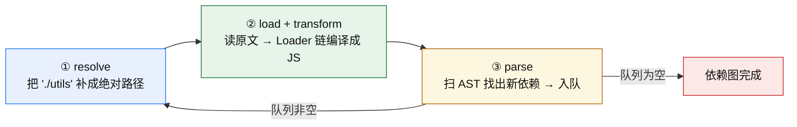
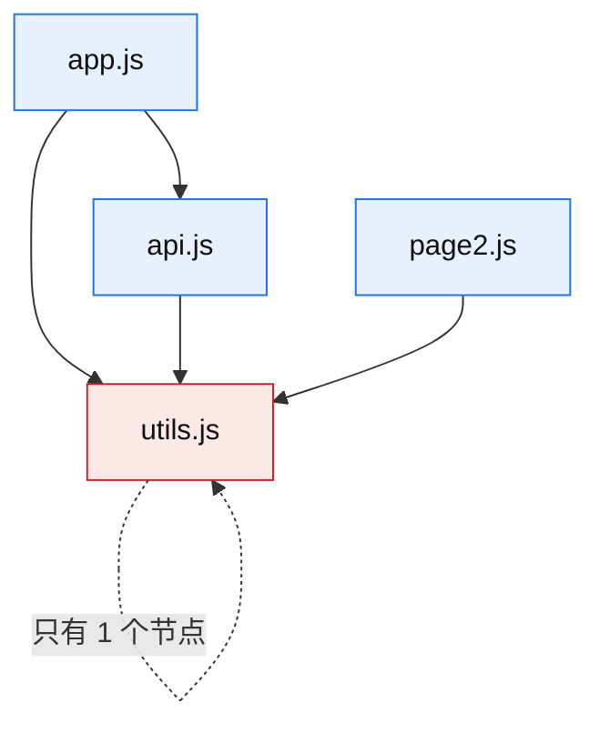
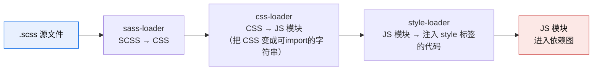
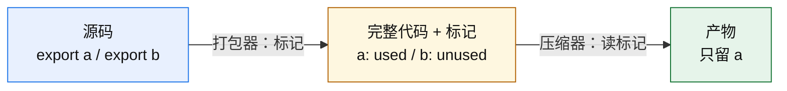
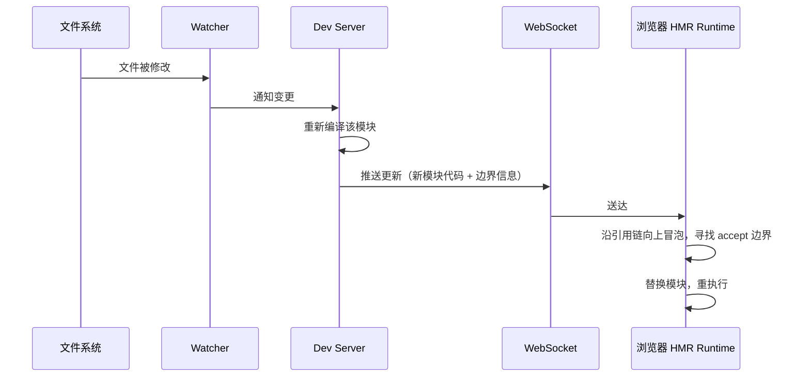
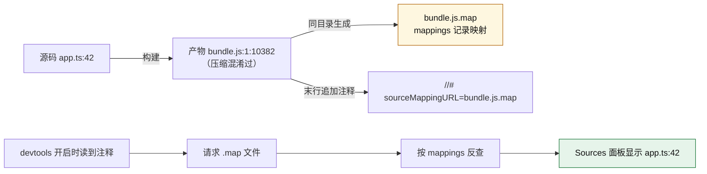
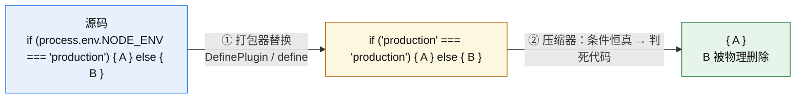

# 第 2 章 · 核心构建原理

> **本章定位**：全书最重要的一章，也是**折旧最慢的一章**。
>
> 依赖图、Loader/Plugin 分工、Tree Shaking 两阶段、代码分割三策略、HMR 边界、dev/prod 差异 —— 这些机制在 Webpack、Rollup、Rspack、Rolldown、Turbopack 里**全部成立**，换的只是执行者。学配置会过期，学这一章不会。
>
> 对应课程：模块 1 · 核心原理（8 节，全部完成并确认）。

**主线索**：

```text
源码  →  依赖图  →  chunk  →  产物
```

其余所有能力，都是挂在这条主线上的分支装置。

---

## 2.1 依赖图：构建器的世界模型

### 定义

**依赖图是一张有向图**：

- **节点** = 模块
- **边** = `import` / `require` / 动态 `import()`
- **根** = 入口

### 它怎么被建出来

构建器从入口出发，循环执行三个动作，直到待处理队列为空：



| 动作 | 做什么 | 受哪些配置影响 |
|---|---|---|
| **resolve** | 把 `./utils` 补成绝对路径 | `resolve.extensions`、`resolve.alias`、`package.json` 的 `exports` |
| **load + transform** | 读原文，交给 Loader 链编译成 JS | `module.rules`（Loader 配置） |
| **parse** | 扫 AST，找出新依赖并入队 | 代码本身的语法是否可静态分析（见 §2.4 的 ESM 前提） |

### 节点里存什么

节点存三样东西：**绝对路径 + 转换后代码 + 依赖列表**。

- **绝对路径用于去重** —— 同一个文件被两条路径引用到，路径归一化后才能认出是同一个模块。
- **代码内容用于输出** —— 去重后只保留一份。

### 图 ≠ 树

这是最容易误解的一点。



`utils.js` 被三条路径引用到，但在图里**只存在一个节点**。这就是「模块单例」语义的来源 —— 模块代码**只执行一次**。

**但这里有一个关键区分，很多人会混：**

| 层级 | 谁决定 | 结果 |
|---|---|---|
| **内存依赖图** | 图遍历时去重 | 共享模块只有 **1 个节点** |
| **产物文件** | `splitChunks` 配置 | **配了才抽公共包**，否则各入口各存一份 |

**易错点**：以为"模块是单例，所以产物里不会重复"。**错。** 图去重和产物去重是**两层的事**。图去重只管内存，产物是否重复由 `splitChunks` 决定。

### 常见的坑

- **以为图是树**：把每个 `import` 都当父子关系，于是理解不了"为什么共享模块只执行一次"。
- **以为路径字符串相同就是同一模块**：`./utils` 和 `./utils.js` 在 resolve 之前是两个不同的字符串。
- **忽略 `exports` 字段的影响**：`package.json` 的 `exports` 会限制哪些子路径能被解析到（这也是一类"装了包但 import 报错"的来源）。

---

## 2.2 入口与输出：从图到 chunk 到文件

### 入口

- `entry` 是依赖图的**起点**。
- 对象写法时，**key 就是 `[name]`**。
- **多入口必须配 `[name]`**，否则产物会互相覆盖（都叫 `main.js`）。

```js
module.exports = {
  entry: {
    app: './src/app.js',
    admin: './src/admin.js',
  },
  output: {
    filename: '[name].[contenthash:8].js',   // 不加 [name] → 互相覆盖
    path: path.resolve(__dirname, 'dist'),   // 必须绝对路径
    clean: true,                             // 防旧产物堆积
  },
};
```

**两个容易踩的点**：

- `output.path` **必须绝对路径**。写成相对路径的行为不可靠（相对于什么，`process.cwd()` 在多包仓库里是变的）。
- **`clean: true` 很值得开**。不开的话，改了文件名之后旧文件会一直堆在 `dist/` 里 —— 本地产物分析会被污染，部署时也可能把过期文件传上去。

### chunk：产物里的文件单位

**chunk = module 的打包容器。1 个 chunk ≈ 产物里 1 个 `.js` 文件。**

**chunk 的三个来源**：

| 来源 | 触发条件 |
|---|---|
| `entry` | 每个入口生成一个入口 chunk |
| 动态 `import()` | 每个动态导入点生成一个懒加载 chunk |
| `splitChunks` | 满足抽包条件的公共模块，合并成一个公共 chunk |

**为什么这个三分法重要**：读产物时看到多出来一个 js 文件，**第一个问题就是"它属于哪一类来源"** —— 这决定了它是谁生成的、谁在什么时候加载它。这是第 7 章「台阶 3 · 会读产物」的第一步动作。

### 内容指纹：三种 hash

| hash 类型 | 计算范围 | 评价 |
|---|---|---|
| `[hash]` | **整个构建** | **禁用** —— 任何改动导致所有文件失效，缓存全废 |
| `[chunkhash]` | **单个 chunk** | 易被**运行时胶水代码污染** —— chunk 内容没改，但运行时片段变了，hash 就变了 |
| `[contenthash]` | **该文件的最终内容** | **生产首选** |

**`chunkhash` 被污染是怎么回事**：一个 chunk 里除了你自己的模块代码，还包含 Webpack 注入的运行时胶水（模块注册表、`__webpack_require__` 之类）。你的代码一行没动，但另一个 chunk 变化导致模块 ID 分配变化 → 胶水变了 → `chunkhash` 变了 → 缓存白白失效。

**`contenthash` 按文件最终内容计算，天然免疫这个问题。**

### 缓存三件套

只改 `filename` 用 `contenthash` 还不够，**三个配置要一起上**：

```js
module.exports = {
  output: {
    filename: '[name].[contenthash:8].js',
    chunkFilename: '[name].[contenthash:8].chunk.js',
  },
  optimization: {
    moduleIds: 'deterministic',   // ① 模块 ID 用确定性算法，不随引用顺序变
    runtimeChunk: 'single',       // ② 把运行时胶水单独抽出来
    splitChunks: { chunks: 'all' },
  },
};
```

| 配置 | 缺了会怎样 |
|---|---|
| `contenthash` | 内容没变文件名也变 |
| `runtimeChunk: 'single'` | 运行时胶水留在各 chunk 里，一改就污染别人 |
| `moduleIds: 'deterministic'` | 模块 ID 按引用顺序分配，加个 import 别人就全变 |

**判据**（第 7 章台阶 3 的核心）：**改一行代码，你能预测哪些产物的 hash 会变吗？** 改不了的三件套，一定会出现"只改了一个按钮文案，用户却要重新下载整个 vendor"。**hash 稳定性不是玄学，是这三项配齐的必然结果。**

### `splitChunks` 的要点

```js
optimization: {
  splitChunks: {
    chunks: 'all',        // 默认只处理 async 的，写 all 才管同步和异步
    minChunks: 2,         // 被 2 个以上 chunk 引用才抽
    cacheGroups: { /* 自定义分组 */ },
  },
}
```

- **`minChunks` 数的是"引用它的 chunk 数量"**，不是"模块数量"。这是常被读错的一个参数。
- **Webpack 5 默认 `chunks: 'async'`** —— 意思是默认**只对动态 import 产生的 chunk 做抽包**，同步入口之间共享的模块**不会自动抽**。所以"抽公共包"不是打包器的默认行为，是你要显式开启的。

### 常见的坑

| 坑 | 后果 | 正确做法 |
|---|---|---|
| 多入口没配 `[name]` | 产物互相覆盖 | 文件名模板必带 `[name]` |
| `output.path` 写相对路径 | 行为不确定 | 用 `path.resolve(__dirname, ...)` |
| 用 `[hash]` | 缓存全废 | 用 `[contenthash]` |
| 以为默认会抽公共包 | 各入口各存一份 | 显式 `chunks: 'all'` |
| `minChunks` 理解成模块数量 | 抽包阈值设错 | 它是**引用 chunk 数** |
| 没开 `clean` | 旧产物堆积污染分析 | `output.clean: true` |

---

## 2.3 Loader 与 Plugin：单文件转换与全流程干预

这是 Webpack 体系里最基础、也最容易判反的一对概念。

### 对照表

| 维度 | Loader | Plugin |
|---|---|---|
| **作用范围** | 单个模块（编译阶段内） | **整个构建流程**（初始化 / 编译 / 生成 / 输出四阶段） |
| **解决什么** | 格式转换（ts / sass / vue / 图片） | 流程干预（抽 CSS、压缩、生成 HTML） |
| **配置形式** | `module.rules` 数组 | `plugins` 数组，`new XxxPlugin()` |
| **能否操作产物** | **不能** | **能** —— 可生成 / 修改 / 删除最终文件 |
| **本质** | 一个「输入代码 → 输出代码」的函数 | 一个带 `apply(compiler)` 的类实例 |

### Loader：一条类型转换管道

**执行顺序：从右到左、从下到上。**

```js
module: {
  rules: [
    {
      test: /\.scss$/,
      use: ['style-loader', 'css-loader', 'sass-loader'],
      //         ↑ 第 3 个执行    ↑ 第 2 个执行    ↑ 第 1 个执行
    },
  ],
}
```

实际执行顺序是 `sass-loader` → `css-loader` → `style-loader`：



**为什么是从右到左**：把它理解成**函数组合** —— `style(css(sass(file)))`，最内层的先执行。数组写法是"书写顺序"而不是"执行顺序"。

**本质是类型转换管道** —— 每一步的输出必须匹配下一步的输入。**顺序写反了不是"配置语法错"，而是喂错了类型**：`sass-loader` 拿到 CSS 会解析失败，或者 `css-loader` 拿到 SCSS 会产出错误结果。

### Plugin：往构建流程里插钩子

```js
class MyPlugin {
  apply(compiler) {
    compiler.hooks.emit.tap('MyPlugin', (compilation) => {
      // compilation.assets 里是即将写出的产物，可以生成/修改/删除
    });
  }
}
```

- **插件是一个类**，通过 `apply(compiler)` 拿到 compiler 对象，再往 `compiler.hooks.xxx` 上 `tap()` 注册回调。
- **可以介入四个阶段**：初始化 → 编译 → 生成 → 输出。
- **能碰产物** —— 这是它和 Loader 最本质的能力差异。

### 判别口诀

> **处理「单个源文件的内容」→ Loader**
> **涉及「构建阶段、跨文件、产物编排」→ Plugin**

**用"流程动作"判断会出错。** 比如"注入 style 标签"，看起来是个流程动作，但它作用在**单个 CSS 模块**上，所以 `style-loader` 是 Loader。而"生成 manifest"要遍历所有 chunk、输出一个新文件，所以 `WebpackManifestPlugin` 是 Plugin。

**判据是「它处理的是谁」，不是「它看起来在干什么」。**

### 常见的坑

| 坑 | 原因 |
|---|---|
| Loader 顺序写反 | 理解为"书写顺序"而不是"管道方向" |
| `test` 正则过窄导致漏转 | 例如只写 `/\.ts$/` 漏掉了 `.tsx` |
| Plugin 忘了 `new` | 直接写 `MyPlugin()` 或 `MyPlugin` 都不对，要 `new MyPlugin()` |
| 想用 Plugin 改单个文件内容 | 那是 Loader 的活；Plugin 该做的是产物编排 |
| 以为 Webpack 插件能迁到 Vite | 钩子体系不同（Tapable vs Rollup），**搬不过去**，见 §3.5 |

---

## 2.4 Tree Shaking：两个执行者的接力

### 两阶段，缺谁都白搭

很多人以为 Tree Shaking 是"打包器的一个开关"。实际上它是**两个执行者的接力**：

| 阶段 | 谁执行 | 干什么 |
|---|---|---|
| **① 标记** | **打包器**（Rollup 内置 / Webpack `optimization.usedExports`） | 给未使用的导出打上 `unused harmony` 标记，**但代码仍完整保留在产物里** |
| **② 删除** | **压缩器**（Terser / SWC minify） | 读取标记，**物理删除**未使用代码并混淆 |



**这个"两阶段"的认知价值在于排错方向**：

- 代码摇不掉 → **先看是标记阶段没生效，还是删除阶段没运行**。
  - 标记没生效：不是 ESM？不是生产模式？`usedExports` 没开？
  - 删除没运行：压缩器被关了（`minimize: false`）、用了不读标记的压缩器。

### 三个概念的粒度对照

| 概念 | 粒度 | 谁提供 |
|---|---|---|
| `usedExports` | **导出的成员** | 打包器（自动） |
| `sideEffects` | **整个模块能否跳过** | **你，在 `package.json` 里手写** |
| Terser / SWC | 单文件 AST | 压缩器 |

### `sideEffects` 的语义

```json
{
  "sideEffects": false
}
```

意思是：**未被引用的模块可以整体跳过**（不进产物）；**有引用则照常执行**。

**例外必须写数组**（否则会误删）：

```json
{
  "sideEffects": ["*.css", "./src/polyfill.js"]
}
```

CSS 文件和 polyfill 是典型的"被引入是为了产生副作用"的模块 —— 它们没有导出被使用，但删掉就坏。**只写 `false` 不写例外，是这类 bug 的经典来源。**

### 两个前提

1. **必须是 ESM。** CJS 的 `require` 是运行时求值，静态分析不了 —— 打包器无法确定"这个导出有没有被用到"。
2. **生产模式才启用。** 开发模式要保证构建快，不做这层分析。

### 最有效的一招

> **改「导入方式」比改配置管用。**

```js
import { debounce } from 'lodash';        // ❌ CJS + 全量导入，摇不掉
import debounce from 'lodash-es/debounce'; // ✅ ESM + 按具体路径导入
```

**为什么这比配 `sideEffects` 更有效**：`sideEffects` 是**库作者**在自己 `package.json` 里写的字段，**消费方改不了**。消费方能控制的只有两件事 —— **从哪个路径导入**、**用什么语法导入**。

**一句话总结**：库写得好不好占一半，你的导入姿势占另一半。

### 常见的坑

| 坑 | 正确认知 |
|---|---|
| 以为 Tree Shaking 一步完成 | 打包器标记 + 压缩器删除，**两个执行者** |
| 在自己项目里配 `sideEffects` 想减小第三方库 | 第三方看库作者；你能做的是改**导入路径** |
| 用了 CJS 库还期待摇树 | `require` 静态分析不了 |
| 开发模式验证摇树效果 | 生产模式才启用 |
| `sideEffects: false` 不写例外 | CSS / polyfill 会被误删 |
| 以为 `import { x } from 'lodash'` 能摇掉 | 包本身是 CJS + 整包导入，摇不动 |

---

## 2.5 代码分割：三种触发方式与一条分界线

### 三种方式

| 触发方式 | 拆分时机 | 加载时机 |
|---|---|---|
| **① 多入口** | 构建期 | **页面级**（不同 HTML 各引各的） |
| **② 动态 `import()`** | 构建期分包 | **运行时按需**（用户触发才下载） |
| **③ `splitChunks`** | 构建期 | **随入口一起** |

### 核心分界线

> **只有 ② 能改变「运行时什么时候下载」。**
> ① 和 ③ 都是**构建期静态拆分** —— 产物变多了，但下载时机没变。

**这条分界线的实用价值**：当有人问"怎么优化首屏"时，**只有 ② 是答案**。① 和 ③ 优化的是"缓存复用"和"并行下载"，不是"首屏要不要下载"。

### 动态 import 的真实效果

```js
const Chart = () => import('./Chart.vue');
button.onclick = async () => {
  const { default: C } = await import('./Chart.js');
  new C().render();
};
```

**效果**：减小**首屏加载体积**。
**不效果**：**不减小总产物体积。** 代码照常打包，只是变成了一个独立的 chunk，被推迟下载。

**这句话是易错点的高发区** —— 很多人说"用了动态 import，包变小了"。准确的表述是"**首屏要下载的字节少了，总量没变**"。

### 两层叠加技巧

把大依赖彻底隔离出首屏的做法：

1. **路由懒加载**：`component: () => import('./views/Heavy.vue')`
2. **组件内再动态 import**：重型依赖（图表库、编辑器）在真正需要时才 `await import()`

先按路由切一刀，再在首屏路由内把大依赖再切一刀。**关键是大依赖不能出现在入口的静态 import 链上。**

### Vite 的差异

- Rollup **自动抽公共包**，不需要配 `splitChunks`。
- 要自定义分组用 `build.rollupOptions.output.manualChunks`。

```js
// vite.config.ts
export default {
  build: {
    rollupOptions: {
      output: {
        manualChunks: {
          'vendor-chart': ['echarts'],
          'vendor-ui': ['element-plus'],
        },
      },
    },
  },
};
```

### 常见的坑

| 坑 | 正确认知 |
|---|---|
| 以为动态 import 能减小总体积 | **只减小首屏体积** |
| 把 ①③ 也当成"按需加载" | 只有 ② 改变运行时下载时机 |
| 以为 Webpack 默认会抽公共包 | 默认 `chunks: 'async'`，只处理动态 import |
| 大依赖留在入口静态链上还想优化首屏 | 静态 import 的都会进首屏 |
| `manualChunks` 分组过细 | chunk 数量爆炸，请求数反而变多 |
| 动态 import 后忘了处理加载态/失败 | 网络会失败，要有 fallback |

---

## 2.6 HMR 热更新：一条从文件改动到模块替换的链路

### 完整链路



### accept 边界

- HMR 从**改动的模块**出发，**沿引用链向上冒泡**。
- 找到**最近一个声明了 `accept` 的模块** → 它就是替换落点。
- **找不到就一直上溯到入口** → **退化为整页刷新**。

**这就是"为什么有时候 HMR 生效、有时候整个页面刷新了"的答案。** 不是 HMR 坏了，是**改动位置到最近边界之间的链路没有可接受的模块**。

### 边界是谁提供的

**框架插件**：

| 框架 | 提供边界的插件 |
|---|---|
| Vue（Webpack） | `vue-loader` |
| Vue（Vite） | `@vitejs/plugin-vue` |
| React | `react-refresh` |

**没有这些插件的裸项目，HMR 会频繁退化成整页刷新** —— 因为没人声明 accept 边界。

### Vite HMR 快的两条腿

1. **不打包** —— 改动后只重新转换那**一个文件**，不需要重新打包受影响的模块图。
2. **沿依赖图做局部化失效传播** —— 只让受影响的模块失效，而不是整图重建。

### 与整页刷新的对比

| | 整页刷新 | HMR |
|---|---|---|
| 浏览器行为 | 重新加载整个页面 | **只替换变更模块** |
| 应用状态 | **全部丢失** | **保留**（未变更模块不重建） |
| 速度 | 慢 | 快 |

**"保留应用状态"是 HMR 真正的价值** —— 改一个弹窗样式，不需要重新点开弹窗、重新填一遍表单。

### 常见的坑

| 坑 | 正确认知 |
|---|---|
| 以为 HMR 总是不刷新页面 | 找不到 accept 边界就**退化为整页刷新** |
| 改了状态相关代码却发现状态丢了 | 该模块在边界之上，必然整体重建 |
| 裸项目期待 HMR 好用 | 边界要框架插件提供 |
| 以为 HMR 影响生产 | **生产模式没有 HMR** |
| 混淆"重新编译"和"重新打包" | Vite dev 只转换单文件，不是打包 |

---

## 2.7 Source Map：调试器与产物之间的反向映射

### 机制



- **构建时产出 `.map` 文件**，记录产物位置 ↔ 源码位置的映射。
- **在产物最后一行追加注释** `//# sourceMappingURL=bundle.js.map`。
- **devtools 开启状态下**加载脚本时读到该注释 → 请求 `.map` → 按 `mappings` 反查 → Sources 面板显示**源码原文**。

**第二种机制**：通过 HTTP 响应头 `SourceMap:` 指定，可以不依赖注释。

**关键性质：Source Map 不改变运行结果。** 它只是给调试器看的一条旁路信息 —— 产物该跑多快还是多快，只是浏览器多下载一个文件。

### devtool 梯度（Webpack）

| devtool | 速度 | 质量 | 适用 |
|---|---|---|---|
| `eval` | 极快 | 差 | dev 迭代 |
| `eval-cheap-module-source-map` | 快 | 中 | **Webpack dev 推荐** |
| `source-map` | 慢 | 最高 | 精确定位 |
| `hidden-source-map` | 慢 | 最高 | **生产：生成但不写注释** |
| `nosources-source-map` | 慢 | 高 | 生产需对外暴露时 |

**dev 的取舍逻辑**：`eval` 系列最快，因为它把 source map 内联进 `eval()` 里，不额外请求文件；代价是映射精度差（`cheap` 表示**只映射到行，不映射到列**）。

### Vite

```js
// vite.config.ts
export default {
  build: {
    sourcemap: false,  // 默认值
    // false | true | 'inline' | 'hidden'
  },
};
```

**Vite 默认 `false`** —— 不生成 source map，产物最小。

### 为什么生产不能用 `source-map`

**注释留在产物里，任何人都能下载 `.map` 还原完整源码 → 源码泄露。**

```js
// ❌ 生产危险配置
devtool: 'source-map'
// 产物末行有注释 → 任何人 curl 一下 .map 就拿到你的全部源码（含注释、含业务逻辑）
```

**正确做法**：

| 场景 | 配置 |
|---|---|
| 想上传 source map 到监控平台（Sentry 等），但不公开 | **`hidden-source-map`** —— 生成 `.map` 但不写注释，手动传给平台 |
| 需要对外的产物但仍想模糊源码 | `nosources-source-map` —— 保留行列映射但**不含源码内容** |
| 完全不需要 | 不生成（Vite 默认即此） |

### 常见的坑

| 坑 | 正确认知 |
|---|---|
| 生产用 `devtool: 'source-map'` | **源码泄露**，用 `hidden-source-map` |
| 以为 source map 会影响性能 | 不改变运行结果，只是多下载一个文件 |
| dev 用最精确的 `source-map` | dev 要的是快，`eval-cheap-module-source-map` 更合适 |
| 以为 devtools 没开也能映射 | **devtools 开启状态下**才会去读注释、请求 `.map` |
| 上了 Sentry 但没配 source map | 堆栈是压缩后的，定位不到源码 |

---

## 2.8 开发模式与生产模式：差异全景与 `mode` 的边界

### 差异全景

| 维度 | 开发模式 | 生产模式 |
|---|---|---|
| 目标 | 构建快、反馈快 | 产物小、加载快 |
| 压缩混淆 | 不做 | Terser / SWC minify |
| Tree Shaking | 不启用 | 启用 |
| Source Map | `eval-cheap-*` 快而糙 | `hidden` 慢而准 |
| 代码分割 | 不抽公共包 | `splitChunks` / `manualChunks` |
| HMR | 启用 | 无 |
| `NODE_ENV` | `development` | `production` |

### 核心机制：构建期字面量替换

这是全章最值得理解透彻的一个机制，因为它同时解释了"环境变量"和"死代码删除"两件事。



| 步骤 | 谁干 | 干什么 |
|---|---|---|
| **① 替换** | **打包器**（Webpack `DefinePlugin` / Vite `define`） | 把 `process.env.NODE_ENV` **整体替换成字符串字面量** `"production"` |
| **② 删除** | **压缩器**（Terser / SWC） | 条件恒假 → 判为死代码 → **物理删除整段** |

**两个执行者，一个都不能少。**

**关键推论**：

- `process` **是 Node 全局对象，浏览器里不存在**。Webpack 不是"提供了 `process`"，而是**在编译期把这段文本换掉了**。
- **静态替换只能替换完整字面量表达式。** `process.env[k]`、`import.meta.env[key]` 这类动态取值**拿不到值**。
- **所以 `NODE_ENV` 不是运行时变量。** 想靠改服务器环境变量来切换前端行为是无效的。

### `mode: 'production'` 自动带来了什么

**它只是预设默认值。** 开启后自动设置：

- `optimization.minimize: true`（Terser 压缩混淆）
- `optimization.nodeEnv: 'production'`（经 DefinePlugin 实现上面第 ① 步）
- `optimization.usedExports: true`（Tree Shaking 标记阶段）
- `optimization.sideEffects: true`
- `optimization.concatenateModules: true`（Scope Hoisting）
- `moduleIds` / `chunkIds: 'deterministic'`
- `devtool: false`（**不生成 source map**）

### `mode` 管不到的

**这是最容易出错的地方 —— 把 `mode` 当"全能开关"。**

| 事项 | 谁来管 |
|---|---|
| 抽公共包 | 显式配 `optimization.splitChunks.chunks: 'all'` |
| 懒加载 | 代码里的 `import()` |
| 剔除 `console` | `terserOptions.compress.drop_console: true` |
| Source map 策略 | 显式配 `devtool` |

**判断口诀**：`mode` 只管"**默认值有没有被设定**"，不管"**你的项目需不需要**"。要显式配置的东西，`mode` 一概不管。

### 配置方式差异（Webpack vs Vite）

| | Webpack | Vite |
|---|---|---|
| 切换方式 | 一份 config + `mode` 字段 | 两条命令 `vite` / `vite build` |
| 环境变量 | `process.env.NODE_ENV` | `import.meta.env.PROD` / `DEV` / `MODE`（默认不注入 `process.env`） |

### 常见的坑

| 坑 | 正确认知 |
|---|---|
| 以为 `mode` 是全能开关 | 它只是预设默认值 |
| 把 `process.env.NODE_ENV` 当运行时变量 | 它是**构建期字面量替换** |
| 动态取 `import.meta.env[k]` | 静态替换只能替换完整字面量 |
| 生产忘了配 `devtool` | `mode: 'production'` 下 `devtool: false`，**默认不生成 source map** |
| 以为 `mode: 'production'` 会删 console | 要显式配 `drop_console` |
| dev 也用 `mode: 'production'` | 会失去 HMR、构建变慢，得不偿失 |

---

## 2.9 本章常见误区（12 条）

| # | 误区 | 正确认知 |
|---|---|---|
| 1 | 以为共享模块在产物里也去重 | 图去重只管内存；产物是否重复由 `splitChunks` 决定 |
| 2 | 把「抽公共包」当打包器默认行为 | Webpack 5 默认 `chunks: 'async'`，只处理动态 import |
| 3 | 以为 loader 顺序错了「所以报错」 | 本质是**类型管道**，喂错类型才断 |
| 4 | 用「流程动作」判断 Loader / Plugin | 判别看**作用域**：单文件 → Loader；跨文件/阶段 → Plugin |
| 5 | 以为 Tree Shaking 一步完成 | 打包器标记 + 压缩器删除，**两个执行者** |
| 6 | 改自己项目 `sideEffects` 想减小第三方库 | 第三方看库作者；你能做的是改**导入路径** |
| 7 | 混淆 `chunkhash` 和 `contenthash` | chunkhash 看「哪个包」，contenthash 看「这份文件」 |
| 8 | 以为动态 import 能减小总体积 | **只减小首屏体积** |
| 9 | 以为 HMR 总是不刷新页面 | 找不到 accept 边界就**退化为整页刷新** |
| 10 | 生产误配 `devtool: 'source-map'` | **会泄露源码**；生产用 `hidden-source-map` |
| 11 | 以为 `mode` 是全能开关 | 它只是预设默认值 |
| 12 | `process.env.NODE_ENV` 当成运行时变量 | 它是**构建期字面量替换** |

---

**下一章**：[第 3 章 · Webpack 与 Vite](03-webpack-and-vite.md) —— 把本章的机制放到两个具体工具上对照。
