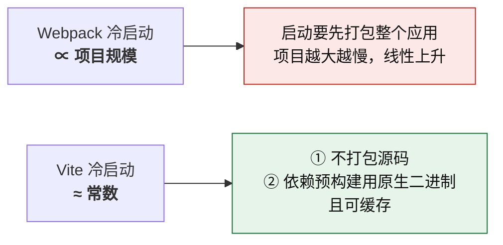

# 第 3 章 · Webpack 与 Vite

> **本章定位**：把第 2 章的通用机制，落到两个具体工具上做对照。
>
> 对应课程：模块 2 · Webpack vs Vite（5 节，全部完成并确认）。
>
> **本章与第 7 章的分工**：本章负责**说清差异**（为什么不同、差在哪），第 7 章 §7.5 负责**给出决策**（在你手上这个项目里该选谁）。不重复。

**主线索**：

> **「快」必须绑定指标；选型必须绑定场景。**
> Webpack 用**配置换控制力**，Vite 用**约定换简洁** —— 两者都没有绝对优劣。

---

## 3.1 架构分野：打包式构建 vs 原生 ESM

这是两个工具所有差异的源头。

### 开发服务器的两种架构


### 对照表

| 维度 | Webpack dev | Vite dev |
|---|---|---|
| **启动时做什么** | 打包整个应用进内存 | 只起 HTTP 服务（+ 依赖预构建） |
| **浏览器拿到** | 1 个完整 bundle | 很多个原始模块文件 |
| **冷启动** | **∝ 项目规模** | **≈ 常数** |
| **首次访问页面** | 快（已打包好） | 略慢（现场转换若干文件） |
| **改动之后** | 重新打包受影响模块 | **只转换那一个文件** |
| **浏览器要求** | 无（产物已降级） | **需支持原生 ESM** |

### 关键区分：「Vite 冷启动快」≠「页面首屏打开快」

这是一个必须分清的区分，因为两者经常被混为一谈。

- **Vite 把成本从「启动时」挪到了「首次访问时」** —— 启动时不用打包，代价是浏览器要现场请求并等待服务端转换。
- **而且这个代价不影响生产** —— `vite build` 仍然走完整打包（Rollup/Rolldown），产出的仍是打包好的产物。

**推论**：

| 说法 | 判定 |
|---|---|
| "Vite 冷启动快" | ✅ 成立 |
| "Vite 首屏快" | ❌ 不一定 —— dev 下反而可能略慢 |
| "Vite 生产构建快" | ❌ 不保证，见 §3.6 |

**为什么这个区分重要**：它决定你在什么场景下能拿"Vite 快"当理由。**开发时省的是你自己的等待，不是用户的加载时间。**

---

## 3.2 依赖预构建：Vite dev 专属的两件事

Vite dev 启动时，会先把 `node_modules` 里的依赖"预构建"一遍，产物放在 `node_modules/.vite`。

**官方的两个目的，顺序不能反：**

| 目的 | 说明 |
|---|---|
| **① CommonJS / UMD 兼容** | dev 以**原生 ESM** 提供代码，而 CJS/UMD 依赖浏览器不认。**不做预构建会直接报错跑不起来**（浏览器不认 `require`） |
| **② 性能** | 内部模块极多的 ESM 依赖会被合并成**单个模块**。例：`lodash-es` 有 **600+ 内部模块**，不合并会产生 600+ 个请求，造成**网络拥塞** |

**为什么①排在②前面**：很多人以为预构建"只是为了快"。实际上**不做就根本跑不起来** —— 这是功能性需求，不是优化。

**关于"600+ 请求"的准确表述**：那是**并发风暴导致的网络拥塞**，不是"请求瀑布"。请求瀑布（waterfall）指**串行的依赖链** —— A 加载完才知道要加载 B，B 加载完才知道要 C。这个区分在第 4 章讲 Farm 的 Partial bundling 时会用到。

### 缓存行为

- **缓存位置**：`node_modules/.vite`
- **失效条件**：只随 **lockfile** / **vite.config** / **NODE_ENV** 变化重跑
- **浏览器端**：依赖请求带 `max-age=31536000, immutable` 强缓存

**实用含义**：遇到"明明改了依赖但没生效"，先删 `node_modules/.vite` 重跑。这是排查 Vite dev 异常的常规动作。

### 执行者

当前官方文档显示依赖预构建由 **Rolldown** 执行（早期为 esbuild）。

**这条信息的价值不在于"记工具名"，而在于**：它是第 4 章整章主题的一个具体实例 —— **同一条流水线上，某一层的执行者被换掉了，但机制没变。**

---

## 3.3 配置方式对比：默认值覆盖了哪一层

### 核心认知

**Vite 配置少，是因为它把大量约定内置成了默认值。**

这与第 2 章 §2.8 的「`mode` 只是预设默认值」是**同一个逻辑**，只是 Vite 的覆盖面**宽得多**。

### 关键差异：默认值管到哪一层

| | 默认值覆盖范围 |
|---|---|
| **Webpack** | 只管**骨架**（入口 / 输出 / 模式），**不管"各类文件怎么被理解"** |
| **Vite** | **连语言层一起管**（TS 转译、CSS、静态资源、资源后缀） |

> **一句话：Webpack 管「东西放哪」，Vite 还管「东西怎么被理解」。**


### 逐项对照表

| 事项 | Webpack | Vite |
|---|---|---|
| 处理 TS / JSX | `module.rules` + babel-loader / ts-loader | **内置** |
| 处理 CSS | `css-loader` + `style-loader` | **内置**，直接 `import './a.css'` |
| 静态资源 | asset modules（v5 已内置，**仍需一行 `type: 'asset/resource'`**） | **内置**，`?url` / `?raw` / `?inline` |
| 路径别名 | `resolve.alias` | `resolve.alias`（**同名，可迁移**） |
| 环境变量 | `DefinePlugin` | `define` + `.env` + `import.meta.env` |
| 开发服务器 | `devServer`（需装 webpack-dev-server） | `server`（内置） |
| 生产构建 | 仍是 Webpack | **Rollup / Rolldown** |
| 插件写法 | `new XxxPlugin()` | `xxx()` **工厂函数** |
| HMR | 需配置 | 内置 |

**一个精度修正**：说"Webpack 的静态资源处理要配 loader"是**不准确**的。Webpack 5 的 asset modules 官方表述是 *"without configuring additional loaders"* —— 但仍需要一行 `module.rules` 的 `type: 'asset/resource'` 声明。**准确说法是「已内置，但需一行规则声明」。**

### 三个常见误判

| 误判 | 为什么错 |
|---|---|
| "生产构建"是差异项 | ❌ 两边默认都是 production |
| "Webpack 什么都要手配" | ❌ 它有默认值，只是只覆盖骨架层 |
| "静态资源"是纯差异项 | ⚠️ 半成立 —— 见上面的精度修正 |

**该举而容易漏的两个例子**：**TS 转译**、**CSS 处理** —— 这两个才是"语言层"的典型代表。

---

## 3.4 环境变量机制：一个被构建期替换"伪造"出的对象

这一节与第 2 章 §2.8 的「构建期字面量替换」同源，只是换到两个具体工具上看。

### 事实

> **`process` 是 Node 全局对象，浏览器里不存在。**

Webpack 不是"提供了 `process`"，而是靠 **`DefinePlugin` 在构建期做文本替换**，把 `process.env.X` 整体换成一个字符串字面量 —— **"伪造"出来的**。

### 两边的做法

**Webpack：**

```js
// webpack.config.js
const webpack = require('webpack');

module.exports = {
  plugins: [
    new webpack.DefinePlugin({
      'process.env.API_URL': JSON.stringify(process.env.API_URL),
    }),
  ],
};
```

**Vite：**

```bash
# .env
VITE_API_URL=https://api.example.com
```

```js
// 代码里
const base = import.meta.env.VITE_API_URL;
```

```js
// 要在 config 里读非 VITE_ 前缀的变量
import { defineConfig, loadEnv } from 'vite';

export default defineConfig(({ mode }) => {
  const env = loadEnv(mode, process.cwd(), '');  // 第三个参数 '' = 不过滤前缀
  return {
    define: {
      __APP_VERSION__: JSON.stringify(env.APP_VERSION),
    },
  };
});
```

### 三条规则

1. **只有 `VITE_` 前缀的变量默认暴露给前端代码。**
   —— 这是**安全设计**：防止服务端密钥（如 `DB_PASSWORD`）意外打进前端产物。
2. **Vite 默认不注入 `process.env`。** 但可以用 `define` 显式达成 —— 所以准确说法不是"Vite 不支持"，而是"**默认不替换**"。
3. **`import.meta.env.X` 同样是静态替换。** 必须写成**完整字面量表达式**，动态取值拿不到。

```js
// ❌ 拿不到值
const key = 'VITE_API_URL';
const url = import.meta.env[key];

// ✅ 必须字面量
const url = import.meta.env.VITE_API_URL;
```

### 为什么这是高频坑

因为它在**开发时可能完全不报错** —— 只是取到 `undefined`，然后你的请求打到了 `undefined/api` 或者相对路径上。**表现为"接口地址莫名其妙不对"，而不是一个明确的语法错误。**

### 常见的坑

| 坑 | 正确认知 |
|---|---|
| 说"Vite 不支持 `process.env`" | 是**浏览器没有 `process`**；Webpack 靠构建期替换伪造 |
| 动态取 `import.meta.env[k]` | **静态替换只能替换完整字面量表达式** |
| 把密钥写成 `VITE_` 前缀 | 会被打进前端产物，**泄露** |
| 以为 `NODE_ENV` 可以运行时切换 | 构建期就定死了 |
| config 里读不到非 `VITE_` 变量 | 用 `loadEnv(mode, cwd, '')` |

---

## 3.5 插件生态对比：一套概念还是两套

### 扩展点的数量

| | 扩展点 | 说明 |
|---|---|---|
| **Webpack** | **两套** | Loader（转单个模块）+ Plugin（管整个流程）—— 写扩展前**先要判断类型** |
| **Vite** | **一套** | 统一的 Plugin（Rollup 插件接口的超集），文件转换在 `transform` 钩子里 |

### 核心取舍

> **Vite 用「少一层概念」换来了插件作者的「多一套适配」。**

**复杂度从使用者（多数）转移到了插件作者（少数）。**

这不是"谁更好"，这是一个明确的**取舍选择**，而且与 Vite"配置少、约定多"是**同一设计逻辑** —— 都是"把复杂度集中到少数人手里，让多数人少做决定"。

**另一面**：Vite 借力 Rollup 生态，**省掉了从零建生态的成本**。这正是第 4 章「双边网络效应」的一个正面实例 —— 它没有另造生态，而是**复用了现成的插件接口**。

### 遇到「某个 loader 在 Vite 里没有对应物」怎么办

**排查优先级，成本从低到高：**


| 优先级 | 做法 | 成本 |
|---|---|---|
| ① | **Vite 内置后缀能力替代** —— `?raw` 替代 raw-loader、`?url` 替代 file-loader、`?inline` 替代 url-loader | **零配置** |
| ② | 找社区 `vite-plugin-*` 或对应 Rollup 插件 | 装一个包 |
| ③ | 直接挂 Rollup 插件（`plugins` / `build.rollupOptions.plugins`） | 需要处理 dev/build 差异 |
| ④ | 换机制不换工具（改用 PostCSS / Babel 插件实现） | 换实现思路 |
| ⑤ | **最后才自己写 Vite 插件** | 自己维护 |

**为什么这个顺序值得记**：它是一条**通用的排查顺序** —— **先替代 → 再复用 → 最后自写**。同样的顺序适用于"构建慢怎么办""依赖冲突怎么办"等一大类问题。

**措辞上的一个修正**：在很多情况下，你根本不需要"替换"某个 loader，而是"**找等价物**"或"**重新实现**"。第 ① 项就是典型 —— 它不需要任何插件。

### 常见的坑

| 坑 | 原因 |
|---|---|
| 以为 Rollup 插件拿来就能用 | **dev 下不打包，`generateBundle` / `writeBundle` 等钩子不触发** |
| 忘配 `apply` | `apply: 'serve' \| 'build'` 决定插件在哪个模式生效 |
| 想把 Webpack 插件迁到 Vite | 钩子体系不同（Tapable vs Rollup），**无法迁移**，只能重写 |
| 一上来就自己写 Vite 插件 | 顺序错了，先看 ①② |
| 在 dev 下调试只在 build 触发的钩子 | 那个钩子在 dev 里根本不会被调用 |

---

## 3.6 速度对比：把「快」拆成四个指标

**本节刻意不给具体倍数。** 理由是倍数**强依赖项目规模、依赖数量、插件数量、机器配置** —— 给了反而误导。

### 两条曲线（机制决定，不是跑分得出）



**Vite 冷启动是「近似」常数而非「严格」常数** —— 因为它启动时仍要做**依赖预构建**（Rolldown / esbuild，原生二进制 + 有缓存），依赖越多这一步越慢。**完整原因是两条叠加**：① 不打包源码 + ② 依赖预构建用原生二进制且可缓存。

### 四个指标的判定

| 说法 | 判定 | 理由 |
|---|---|---|
| "Vite **冷启动**更快" | ✅ 通常成立 | 规模越大差距越大（两条曲线斜率不同） |
| "Vite **开发体验**更快" | ✅ 通常成立 | 冷启动 + HMR 都占优 |
| "**Vite 构建更快**" | ❌ **不保证** | build 走 Rollup/Rolldown **单线程**，超大项目可能更慢 |
| "Vite **页面首屏**更快" | ❌ 不一定 | dev 下首屏反而略慢（见 §3.1） |

> **"Vite 快"只属于 dev，不属于 build。**
> 把它当成通用结论，是选型时最常见的一类依据错误。

### 别忘了 Webpack 的缓存

**Webpack 5 的持久化缓存 `cache: { type: 'filesystem' }` 让二次构建接近增量。** 讨论"谁更快"时，拿一个**没开缓存**的 Webpack 去比，是不公平的对比。

```js
module.exports = {
  cache: {
    type: 'filesystem',       // 持久化到磁盘
    buildDependencies: {
      config: [__filename],   // config 变了才失效
    },
  },
};
```

### 测量方法

**六步法**（第 5 章 §5.6 展开）：

1. **拆指标** —— 冷构建 / 增量构建 / HMR / 首屏，一次只测一个
2. **固定变量** —— 同机器、同代码规模
3. **清三层缓存** —— `node_modules/.cache`、`node_modules/.vite`、浏览器无痕
4. **各跑 5 次取中位数** —— 单次测的是系统负载，不是构建性能
5. **记录元数据** —— 代码行数 / 依赖数 / 插件数
6. **出带前提的结论**

### 常见的坑

| 坑 | 正确认知 |
|---|---|
| 说"Vite 构建更快" | build 走单线程，超大项目可能更慢 |
| 拿厂商基准数字当自己的结论 | 厂商数字是**起点**，不是**判据** |
| 比较时 Webpack 没开持久化缓存 | 不公平对比 |
| 只跑一次就下结论 | 单次测的是系统负载 |
| 不区分冷启动和首屏 | 两者机制不同，结论相反 |
| 不记录代码规模就报倍数 | 结论无法复现 |

---

## 3.7 本章常见误区（12 条）

| # | 误区 | 正确认知 |
|---|---|---|
| 1 | 以为 Vite dev 依赖预构建只是为了性能 | 首要理由是 **CJS/UMD → ESM 兼容**；不做则直接跑不起来 |
| 2 | 把"600+ 请求"叫**请求瀑布** | 那是**并发风暴导致的网络拥塞**；瀑布指**串行依赖链** |
| 3 | "Vite 冷启动快" = "首屏快" | 成本被**挪到首次访问**；且不影响生产 |
| 4 | 说"Webpack 什么都要手配" | Webpack 有默认值，只是只覆盖**骨架层** |
| 5 | 说"Vite 不支持 `process.env`" | 是**浏览器没有 `process`**；Webpack 靠构建期替换伪造 |
| 6 | 动态取 `import.meta.env[k]` | 静态替换只能替换**完整字面量表达式** |
| 7 | 以为 Rollup 插件拿来就能用 | dev 不打包，`generateBundle` 等钩子**不触发** |
| 8 | 一上来就自己写 Vite 插件 | 顺序：**内置后缀替代 → 社区插件 → Rollup 插件 → 自写** |
| 9 | 说"Vite 构建更快" | build 走单线程，超大项目可能更慢 |
| 10 | 选型先算 ROI | 应先问**有没有真实痛点**；无痛点则收益侧为空 |
| 11 | 组件库直接用 Vite 默认配置 | 需 dts 插件、显式 `formats`、`external` peer、对齐 `exports` |
| 12 | 选型理由是"更现代 / 更先进" | 理由必须**对着场景需求**说 |

---

**下一章**：[第 4 章 · 新一代构建工具](04-next-generation-tools.md) —— 当同一条流水线的每一层，都换成了 Rust / Go。
