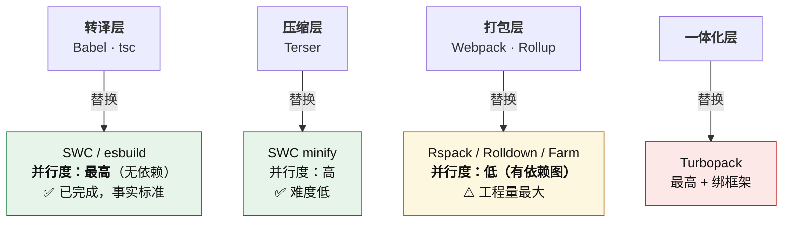
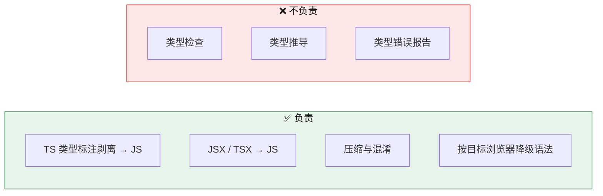
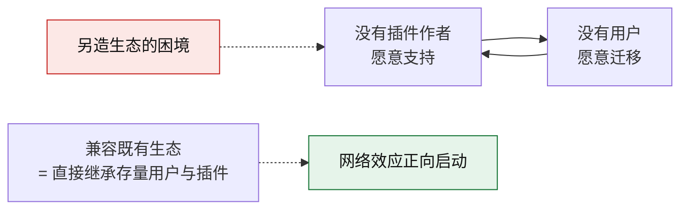
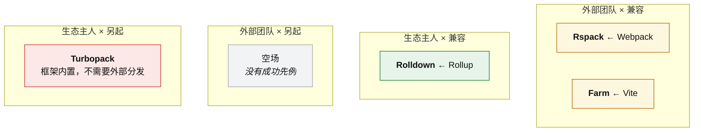

# 第 4 章 · 新一代构建工具

> **本章定位**：讲正在发生的变化。**本章折旧最快** —— 工具名和版本号会过期，但"分层替换"和"兼容还是另起"这两条判断不会。
>
> 对应课程：模块 3 · 新趋势（6 节；其中 §3.5 AI 辅助构建独立成第 6 章）。
>
> **版本敏感提示**：本章涉及版本号、成熟度与性能数据的陈述，均于 **2026-10-10** 核验自官方站点 / 官方博客 / 发布记录。工具链演进快，阅读时若与当前官方文档不符，**以官方文档为准**。核验清单见 `appendix/references.md`。

**主线索**：

> **「换引擎」是这一轮的全部主题。**
> 四条路线用四种方式把 JS 引擎换成 Rust / Go，但只有**三种打法**。
> 判断该学什么，看**折旧率**，不看新旧。

---

## 4.1 为什么原生化：并行度决定难度

### 问题在哪

构建这件事的很大一部分是「**逐文件文本转换**」—— 把 TS 转成 JS、把 SCSS 转成 CSS、把 JS 压缩。这类工作有两个特点：

- **CPU 密集**
- **天然可并行** —— 文件 A 的转换不依赖文件 B 的转换结果

**但 JavaScript 是单线程的**，用不上多核。

### 原生的三个优势

| 优势 | 说明 |
|---|---|
| **机器码无预热** | 无需 JIT 预热，启动即满速 |
| **真多核** | 可以真正使用多核并行 |
| **紧凑内存** | 数据布局更紧凑，序列化 / 反序列化开销更低 |

### 分层替换路线图



| 层 | 并行度 | 难度 | 现状 |
|---|---|---|---|
| 转译层 | **最高**（无依赖） | 低 | **已完成，事实标准** |
| 压缩层 | 高 | 低 | 已完成 |
| **打包层** | **低（有依赖图）** | **最高** | 四方混战 |
| 一体化层 | — | 最高 + 绑框架 | 单框架内已默认 |

### 核心结论

> **并行度决定原生化难度。**
> 打包层最难，因为**依赖图是串行约束** —— 你必须先知道谁依赖谁，才能决定怎么打包。这份"先知道"的关系，无法像"转换单个文件"那样简单并行。

**这条结论的实用价值**：它解释了为什么"转译层早就换完了，打包层还在打"。这不是"打包层的人不努力"，是问题本身的并行度不同。

**一个精度修正**：说"前端构建是纯单线程"并不准确。**Webpack 5 里 Terser 默认 `parallel: true`**（用 worker 线程），**并非纯单线程**。换 SWC minify 的收益来自 ① 原生执行速度 ② **更低的序列化 / 内存开销**（worker 之间传递数据本身有成本）。

---

## 4.2 esbuild 与 SWC：转译与压缩层

这两个工具最可能被真正用上，因为可以**单独替换**，不牵动整个构建流程。

### 对照表

| 维度 | esbuild | SWC |
|---|---|---|
| **实现语言** | Go | Rust |
| **定位** | "够用就好"的极速转译器 | **"Babel 的替代品"** |
| **类型检查** | ❌ 不做 | ❌ 不做 |
| **Babel 插件兼容** | ❌ | **部分** |
| **打包能力** | 有基础能力，但生态不足 | 无 |
| **典型场景** | Vite dev 转译、依赖预构建 | Next.js、`swc-loader`、`@swc/jest` |

### 共同边界：只剥离类型标注，不验证类型

**这是本节最重要的认知。**



> **esbuild 与 SWC 都不做类型检查 —— 它们只剥离类型标注，不验证类型是否正确。**

### 直接后果：`vite build` 默认不会因类型错误失败

**这一点极其容易踩。** 你的项目里可能有 30 个类型错误，`vite build` 照样构建成功、照样产出产物、照样能部署。

**正确做法**：显式把类型检查挂到构建脚本或 CI：

```json
{
  "scripts": {
    "dev": "vite",
    "build": "vue-tsc --noEmit && vite build",
    "build:react": "tsc --noEmit && vite build"
  }
}
```

| 命令 | 适用 |
|---|---|
| `tsc --noEmit` | React / 纯 TS 项目 |
| `vue-tsc --noEmit` | Vue 项目 |

**推论**：看到"类型检查"这件事，要问**谁在做** —— 转译器不做，那是**另一条独立的流水线**在管（TS 编译器）。**转译和类型检查是两件事，只是过去 Babel + tsc 的组合让人以为它们是一体的。**

### SWC 不能完全替代 Babel

| | Babel 插件 | SWC 插件 |
|---|---|---|
| 实现语言 | JavaScript | **Rust / WASM** |
| 能否互搬 | — | **搬不过去** |

**所以"把 Babel 换成 SWC"的真实成本，取决于你用了多少 Babel 插件、以及这些插件有没有 SWC 等价物。** 一个用了 5 个 Babel 插件的老项目，动手前必须先把插件清单核一遍 —— 这是第 7 章 §7.3 台阶 5「迁移评估」的一个具体场景。

### 常见的坑

| 坑 | 正确认知 |
|---|---|
| 以为 esbuild / SWC 能做类型检查 | **只剥离类型标注，不验证类型** |
| 以为 `vite build` 会因类型错误失败 | **默认不会**，需显式挂 `tsc --noEmit` |
| 以为 SWC 能完全替代 Babel | 插件体系不同（Rust/WASM vs JS），**搬不过去** |
| 以为 esbuild 能直接替代 Webpack 打包 | 打包能力与生态都不具备 |
| 忽略装饰器语义差异 | TS 装饰器在不同实现下语义有差别，需实跑验证 |
| 以为换原生转译器一律"快很多" | 小项目上收益不明显，瓶颈可能在别处 |

---

## 4.3 Rspack 与 Farm：借别人的生态

这两条路线的共同点：**都选择兼容一个既有生态，而不是另造一套。**

### 对照表

| 维度 | Rspack | Farm |
|---|---|---|
| **兼容目标** | **Webpack** | **Vite** |
| **配置** | `rspack.config.js`（≈ webpack 配置改名） | `farm.config.ts`（**需重写**） |
| **插件** | loader runner 与 Webpack **完全兼容**；top 50 webpack 插件 **>80%** 可用或有替代 | `vitePlugins` 直接挂 Vite / Rollup / unplugin 插件 |
| **成熟度** | **高**（1.x 生产可用；字节内部 >1000 应用） | 中（独立项目，生态小） |
| **差异化** | Module Federation 2.0 | **Partial bundling** |

**采用方**：Rspack 在字节内部有 >1000 个 Web 应用（抖音、飞书、Coze），外部有微软、亚马逊、阿里、Discord 等。Farm 2023 年开源，2024–2025 达生产可用，生态与社区规模明显小于 Rspack。

### 核心机制：为什么必须兼容

> **生态迁移成本 > 重写成本，所以必须兼容。**

**这不是"性价比考虑"，是生存条件。** 关键机制是**双边网络效应**：



**机制拆解**：

- 插件作者**没有动力**为"没有用户的新工具"重写插件 —— 而他们的用户都还在 Webpack / Vite 上。
- **所以另造生态不是"成本高"，是"冷启动根本起不来"。**

**边际成本对照**：

| 做法 | 边际成本 | 可控性 |
|---|---|---|
| 兼容 | 在 Rust 侧实现一套 JS 插件运行器（**一次性投入**） | **自己可控** |
| 造生态 | 说服成千上万第三方作者（**持续投入**） | **不可控** |

**一个决定性的先例**：**Vite 自己就是这么起来的** —— 直接复用 Rollup 的插件接口（见 §3.5）。这不是巧合，是**唯一被验证过的路径**。

**策略层的一层**：**兼容谁 = 抢谁的存量用户。** Rspack 选 Webpack、Farm 选 Vite，两条路线选了不同的兼容对象，**同时避免了彼此同质化**。

### Rspack 迁移清单

| 原来 | 换成 |
|---|---|
| `HtmlWebpackPlugin` | `HtmlRspackPlugin` |
| `MiniCssExtractPlugin` | `CssExtractRspackPlugin` |
| `css-loader` | 内置 `type: 'css'` |
| `babel-loader` / `swc-loader` | **`builtin:swc-loader`** |

**关于 `builtin:swc-loader`**：推荐它是因为**避免 JS ↔ Rust 之间的往返通信开销** —— 在 JS 侧跑一个 loader，数据要序列化传给 Rust 再传回来，这个开销在大量文件上很可观。确需 Babel 插件时，应把它的作用范围限制在少数文件上。

**少数不支持项**：`resolve.plugins` 等。所以"完全兼容"这个说法要精确 —— 是**"几乎全部社区 loader 可用 + top 50 插件 >80% 可用或有替代"**，不是 100%。

### Farm 的两个特有概念

**① `vitePlugins`**

```ts
// farm.config.ts
export default defineConfig({
  vitePlugins: [
    // 直接挂 Vite / Rollup / unplugin 插件
  ],
});
```

**② 三类插件，其中 JS 插件必须配 `filters`**

| 类型 | 例 |
|---|---|
| Farm Rust 插件 | `@farmfe/plugin-react`、`@farmfe/plugin-sass` |
| **Farm JS 插件** | **必须配 `filters`，否则明显掉速** |
| SWC 插件 | SWC 生态插件 |

**`filters` 的作用**：告诉 Rust 侧"哪些文件才需要调用这个 JS 插件"。不配的话，**每个文件都要跨语言往返一次**，性能优势直接被吃掉。

**③ Partial bundling**

Farm 的独有策略，**介于"全打包"与"不打包 ESM"之间**：既避免"不打包"导致的请求瀑布，也避免"全打包"产生巨型产物。

**为什么这个中间态有意义**：§3.2 讲过两个问题 —— **请求瀑布**（串行依赖链）和**网络拥塞**（并发太多）。Partial bundling 是在两者之间找一个平衡点。

### 常见的坑

| 坑 | 正确认知 |
|---|---|
| 以为"兼容"等于 100% 无痛迁移 | 是"几乎全部 loader + top 50 插件 >80%" |
| 以为另造生态只是"成本高" | 是**冷启动起不来**（双边网络效应） |
| Farm 的 JS 插件不配 `filters` | 明显掉速 |
| 在 Rspack 里继续用 `babel-loader` | 应换 `builtin:swc-loader`，减少跨语言往返 |
| 以为配置能直接改名就用 | Farm 的 `farm.config.ts` **需要重写** |

---

## 4.4 Turbopack 与 Rolldown：另外两种打法

前两条路线都是"借别人的生态"。这一节是另外两种：**一条谁都不兼容**，**一条由生态主人自己动刀**。

### 对照表

| 维度 | Turbopack | Rolldown |
|---|---|---|
| **归属** | Vercel（Next.js） | VoidZero（Vite 团队） |
| **兼容对象** | **无** | **Rollup 插件 API** |
| **默认落地** | **Next.js 16**（2025-10）dev 与 build 双双默认 | **Vite 8**（2026-03-12）默认；**Rolldown 1.0**（2026-05-07） |
| **核心卖点** | 函数级增量 + 落盘、单图覆盖多环境、dev 懒编译 | **dev / prod 同一引擎（parity）**；官方称比 Rollup 快 10–30x |
| **硬约束** | **不支持 webpack 插件**；有 `webpack()` 配置则 `next build` **直接失败** | Node **20.19+ / 22.12+**；**ESM-only**；**Yarn PnP 兼容问题**（Windows 尤甚） |

### 核心洞见：谁能不兼容

> **只有"能连用户一起换"的玩家才敢不兼容。**

Turbopack 敢，因为**打包器不是独立选项** —— 它被包在框架里，用户升级 Next.js 就自动换了。


**敢不兼容的三个条件**：

| 条件 | 说明 |
|---|---|
| ① **有分发渠道** | 打包器被包在框架里，随框架一起分发 |
| ② **回退高摩擦** | 不是禁止，而是把回退做成**"逆默认值"**操作 |
| ③ **有资格** | 足够大的用户基数 + 不可替代性 |

> **强制 ≠ 禁止。强制 = 默认 + 高摩擦回退。**

**为什么"高摩擦"就够**：`--webpack` 这个 flag 一直都在，技术上完全可行。但**大多数团队不会去按** —— 因为默认值已经能满足需求，而按下去意味着"我知道得比框架作者多"。**门槛不在于能不能做，在于要不要为它付出额外的心智成本。**

**推论**：**没用户基数的工具学这招会直接死。** 三个条件缺一个，强制就变成自杀。

### Turbopack 的三条设计

支撑它速度的是三件事：

| 设计 | 说明 |
|---|---|
| ① **单张模块图** | 浏览器 + Node + Server Components **共用一张图**（不用为不同环境各建一张） |
| ② **函数级增量 + 落盘** | 增量计算的缓存粒度到**函数级**，并持久化到磁盘（16.1 dev 落盘，16.3 build 默认开） |
| ③ **dev 懒编译** | 只编译**访问到的路由**，不编译整个应用 |

**其他事实**：

- 转换用 **SWC**，CSS 用 **Lightning CSS**。
- **不做类型检查** —— `next build` 另行跑 TypeScript。
- 自有 loader 语法 `experimental.turbo.rules`，**非全部 webpack loader 可用**。
- Sass 的 `~` 前缀不再支持。
- Vercel 口径：生产构建快 2–5x、Fast Refresh 快至 10x。**厂商自测数据，需按项目自测。**

**关于"webpack 配置导致 build 失败"**：这是**故意设计** —— `next.config` 里存在 `webpack()` 函数时，`next build` **直接失败**，拒绝静默忽略。三条出路：把配置迁移到 `turbopack` 键 / 忽略 webpack 配置构建 / 显式 `--webpack` 退回。

### Rolldown 的时间线与收益

**时间线**：

```text
2024-04  首发 0.10.1
2024-12  1.0.0-beta.1
2025-05  rolldown-vite 预览
2025-12  Vite 8 Beta
2026-01  1.0 RC
2026-03-12  Vite 8.0 稳定 —— Rolldown 成为默认
2026-05-07  Rolldown 1.0 稳定
```

**技术底座**：Rust，构建在 **Oxc** 之上，**兼容 Rollup 插件 API**。

**Vite 8 的变化**：单引擎取代 esbuild(dev) + Rollup(build)；转换改由 **Oxc**，CSS 压缩改由 **Lightning CSS**。

**官方口径**：比 Rollup 快 **10–30x**，与 esbuild 持平。

**官方公布的真实案例**：Linear 46s→6s（-87%）、GitLab 2.5min→22s、Ramp -57%、Beehiiv -64%、Mercedes-Benz.io -38%。

### 最值钱的收益不是速度，是 parity

> **Rolldown 最被低估的收益是 dev / prod 一致性。**

**问题是什么**：以前 esbuild(dev) 与 Rollup(build) 是**两套模块解析、两套转换、两套 tree-shaking 语义**。同一份代码在 dev 下能跑，build 之后行为变了 —— 而且**只在部署后暴露**。

**统一引擎之后**：本地测的就是要发布的，**"本地能跑、生产挂"这一整类 bug 消失**。

**为什么一致性比速度值钱**：

| 维度 | 速度提升 | 一致性提升 |
|---|---|---|
| 上限 | 有上限，且一次性 | 问题的**排查成本与业务风险无上限** |
| 替代方案 | **有** —— 增量缓存、换机器、加人 | **没有** —— 除了统一引擎 |
| 暴露时机 | 立刻可见 | 不修就一直有 |

**一个有力的反证**：**Vite 8 的 dev HMR 速度相比 Vite 7 基本没变** —— 收益在生产构建与依赖预构建。**如果只图速度，这次升级的收益会很尴尬。**

### Rolldown 的其他要点

- **内置能力**（省掉插件）：CJS/ESM 互操作（免 `@rollup/plugin-commonjs`）、Node 解析（免 `@rollup/plugin-node-resolve`）、`output.codeSplitting`。
- **配置变化**：`build.rollupOptions` → **`build.rolldownOptions`**。
- **硬约束**：Node **20.19+ / 22.12+**；包变为 **ESM-only**；**Yarn PnP 兼容性有问题（Windows 尤甚）**。

### 常见的坑

| 坑 | 正确认知 |
|---|---|
| 以为 Turbopack 可以通用 | **框架内置**，离开 Next.js 无意义 |
| 以为 Turbopack 会做类型检查 | `next build` 另行跑 TS |
| 以为 Turbopack **"没有替代品"** | 仍可显式 `--webpack`。**强制 = 默认 + 高摩擦回退**，不是禁止 |
| 以为 Vite 8 的收益在 dev | **HMR 相比 Vite 7 基本没变**，收益在生产构建与依赖预构建 |
| 以为换引擎只是"变快" | 产物结构与体积是**另一回事**，必须回归对比 |
| 忽略 Rolldown 的 ESM-only 与 Node 版本要求 | 老项目升级前先核对 |
| 忽略 Yarn PnP 兼容问题 | Windows 上尤其注意 |

---

## 4.5 成熟度矩阵与投入建议

### 判断原则

> **看折旧率，不看新旧。**

**三条判据**：

| 判据 | 含义 |
|---|---|
| ① **层越低，折旧越慢** | 转译层（SWC/esbuild/Oxc）已定型；打包层还在洗牌 —— 背配置的折旧极快 |
| ② **是否已在默认路径上** | 在默认路径上的，重点是从"用过"变成"知道它为什么在那儿" |
| ③ **是否兼容存量生态** | 兼容的，收益可立刻兑现；另起的，学了只对一个框架有效 |

### 成熟度矩阵

| 工具 | 层 | 成熟度 | 投入建议 |
|---|---|---|---|
| **SWC / esbuild** | 转译 · 压缩 | 事实标准 | **已在用** —— 不必特意学，需知其为何快 |
| **Oxc / Lightning CSS** | 解析 · 转换 · CSS | 上升中 | **了解即可** |
| **Rspack** | 打包 | 生产可用（1.x） | **值得学** —— 存量提速首选 |
| **Rolldown** | 打包 | 1.0 稳定 | **值得学** —— Vite 8 已默认 |
| **Turbopack** | 打包（框架内置） | Next.js 16 默认 | **仅 Next.js 用户需要** |
| **Farm** | 打包 | 可用但生态小 | **观察** |

### 四条路线的 2×2 全景



**注意第 Q3 象限是空的** —— **"外部团队 + 另起生态"没有成功先例**。这不是巧合，是双边网络效应在起作用（§4.3）。

### 模块 3 的最终结论

> **模块 1（第 2 章）的知识折旧最慢。**

依赖图、Loader/Plugin 分工、Tree Shaking 两阶段、代码分割三策略、dev/prod 差异 —— 在 Rspack、Rolldown、Turbopack 里**全都还在**，只是换了执行者。

**这是整章最重要的产出**：它告诉你该把学习时间投在哪。

### 常见的坑

| 坑 | 正确认知 |
|---|---|
| 按"谁最新"决定学什么 | 判据是**折旧率 + 默认路径 + 兼容对象** |
| 花时间背 Rspack 的配置项默认值 | 学"为什么兼容、迁移要核对什么"值；背每个字段默认值不值 |
| 以为 Turbopack 通用 | 框架内置 |
| 以为换引擎只是"变快" | 产物结构与体积要回归对比 |
| 现在就在新项目押注 Farm | 生态未成型，可能打水漂 |

---

## 4.6 本章常见误区（14 条）

| # | 误区 | 正确认知 |
|---|---|---|
| 1 | 以为 esbuild / SWC 能做类型检查 | **只剥离类型标注，不验证类型** |
| 2 | 以为 `vite build` 会因类型错误失败 | **默认不会**，需显式挂 `tsc --noEmit` |
| 3 | 以为 SWC 能完全替代 Babel | 插件体系不同（Rust/WASM vs JS） |
| 4 | 以为 esbuild 能直接替代 Webpack 打包 | 打包能力与生态都不具备 |
| 5 | 以为"兼容"等于 100% 无痛迁移 | Rspack 是"几乎全部 loader + top 50 插件 >80%" |
| 6 | 以为另造生态只是"成本高" | 是**冷启动起不来**（双边网络效应） |
| 7 | 以为 Turbopack 可以通用 | **框架内置**，离开 Next.js 无意义 |
| 8 | 以为 Turbopack 会做类型检查 | `next build` 另行跑 TS |
| 9 | 以为 Turbopack"没有替代品" | 仍可 `--webpack`。**强制 = 默认 + 高摩擦回退** |
| 10 | 以为 Vite 8 的收益在 dev | **HMR 相比 Vite 7 基本没变**，收益在生产构建与预构建 |
| 11 | 以为换引擎只是"变快" | 产物结构与体积是**另一回事**，必须回归对比 |
| 12 | 按"谁最新"决定学什么 | 判据是**折旧率 + 默认路径 + 兼容对象** |
| 13 | 忽略 Rolldown 的 ESM-only 与 Node 版本要求 | 升级前先核对 |
| 14 | 说"前端构建是纯单线程所以慢" | Webpack 5 的 Terser 默认 `parallel: true`，**并非纯单线程** |

---

**下一章**：[第 5 章 · 构建性能优化](05-build-performance.md) —— 把"更快"变成一个可以验证的结论。
