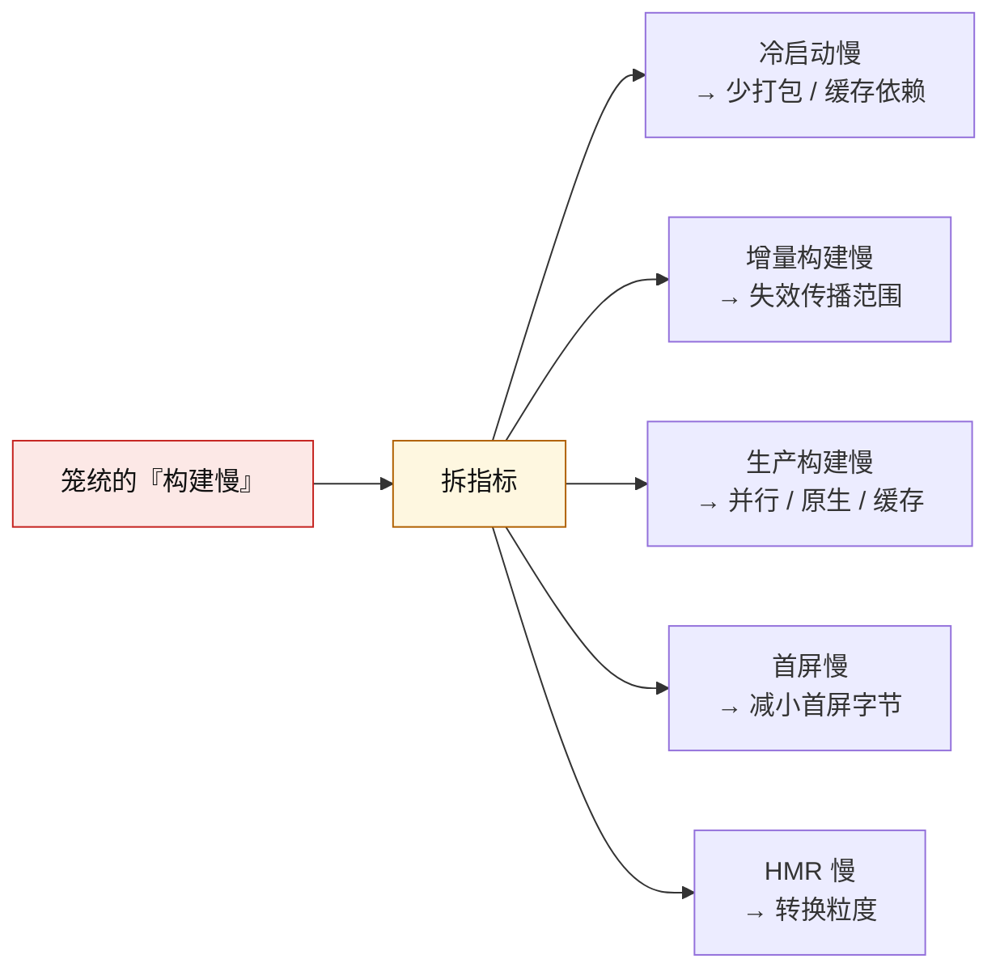
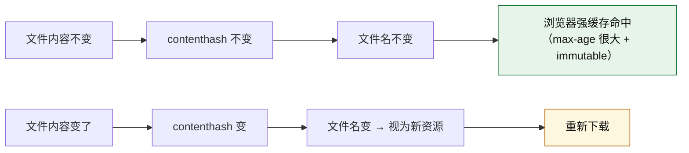
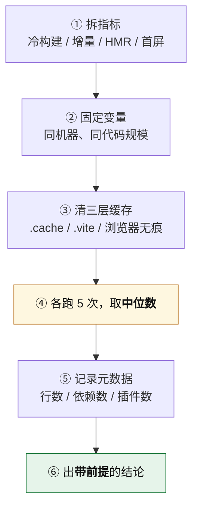

# 第 5 章 · 构建性能优化

> **本章覆盖度特别说明（请先读）**
>
> 与其余章节不同，**本章没有对应的独立教学模块**。课程中没有专门讲"构建性能优化"这一主题，相关内容散落在三处：
>
> - 模块 2 §4「冷启动与构建速度」—— 讲了指标拆分与测量方法【已学】
> - 模块 3「原生工具链」—— 讲了并行、增量、缓存机制【已学】
> - 模块 4 §4.2 台阶 4「会算账」—— 讲了基准测量的判据【已学】
>
> **本章把这些散落点归拢成章，并逐节标注来源。标注为【补充背景】的部分是编纂者为让本章自洽而补写的通识内容，课程中未讲过。**
>
> 逐节覆盖度汇总见 §5.7。

**主线索**：

> **优化的前提是「能证明」。**
> 不能证明"问题在这里"就动手，本质是在赌。而能证明的最小单位，是**一个绑定好指标与前提的数字**。

---

## 5.1 优化的前提：先有指标，再有结论【已学】

### 一句话

> **"更快"不是结论，"哪个指标快了、在什么前提下、怎么测的"才是。**

### 四个必须分开的指标

| 指标 | 定义 | 谁在等它 |
|---|---|---|
| **冷启动** | dev server 从启动到可用 | **开发者**（一天几次） |
| **增量构建** | 改一个文件到产物更新 | **开发者**（高频） |
| **HMR 响应** | 改一个文件到浏览器完成替换 | **开发者**（最高频） |
| **生产构建** | 从零到 `dist/` 完成 | **CI**（一天几次到几十次） |
| **首屏加载** | 用户从请求到可用 | **用户**（最该优化，但最容易被混淆） |

**为什么要分这么细**：因为这五个指标的优化手段**几乎不重叠**。



**不拆指标的后果**：你可能会为了优化 CI 上的生产构建，去改 dev server 的配置 —— 完全无效，但看起来"做了优化"。

### 三类最容易混淆的"快"

| 说法 | 实际说的是 | 常见误用 |
|---|---|---|
| "Vite 快" | **dev 冷启动 + HMR** 快 | 被用来论证"生产构建也快"（❌） |
| "构建快" | 通常指**生产构建** | 被用来论证"开发体验好"（❌） |
| "首屏快" | 用户侧加载 | 被用来论证"构建工具选得好"（❌，两者机制不同） |

**判据**：听到"更快"，先问三个问题 —— **哪个阶段？什么前提？怎么测的？**

---

## 5.2 三类耗时来源与各自的优化手段【已学 + 补充背景】

构建耗时按**来源**分三类，每类的解法不同。

| 耗时来源 | 典型占比 | 优化手段 | 标注 |
|---|---|---|---|
| **① 模块转换** | 大 | 换原生转译器（SWC / esbuild / Oxc） | 【已学】 |
| **② 依赖解析与打包** | 大（大项目尤甚） | 换原生打包器（Rspack / Rolldown）；减少模块数量 | 【已学】 |
| **③ 产物优化**（压缩 / 混淆 / 摇树） | 中 | 换原生压缩器；并行化 | 【已学】 |
| **④ 插件执行** | 不定，可能是隐藏大头 | 精简插件；避免 JS ↔ 原生往返 | 【已学】 |
| **⑤ I/O 与文件系统** | 小到中 | 缓存；SSD | 【补充背景】 |

### 一个常被忽略的点：插件是隐藏的大头

Rspack 推荐用 `builtin:swc-loader` 而不是 `babel-loader`，理由正是这个 —— **在 JS 侧跑 loader，数据要序列化传给 Rust 再传回来**，这个往返开销在大量文件上很可观。

**同理**：Farm 的 JS 插件**必须配 `filters`**，不配的话每个文件都要跨语言往返一次，原生带来的优势直接被吃掉。

> **通用判据**：跨语言 / 跨进程边界的调用，**要么批量化，要么加上过滤条件**。

### 减少模块数量为什么有效

**因为构建的核心工作量与模块数量成正比**（每个模块都要 resolve → load → transform → parse）。所以：

- `lodash` 全量导入 → `lodash-es/debounce` 按路径导入，**不只是摇树问题，也直接减少被处理的模块数**。
- 依赖预构建把 `lodash-es` 的 600+ 内部模块合并成 1 个，**既省请求，也省 dev 下的处理量**。

---

## 5.3 缓存：三层结构与各自的失效条件【已学】

**缓存是投入产出比最高的一类优化** —— 它不改变构建的机制，只是让重复的部分不重做。

### 三层缓存

| 层 | 位置 / 机制 | 失效条件 | 标注 |
|---|---|---|---|
| **① 构建工具缓存** | Webpack `cache: { type: 'filesystem' }` | 配置变化 / 版本变化 | 【已学】 |
| **② 依赖预构建缓存** | `node_modules/.vite` | **lockfile / vite.config / `NODE_ENV` 变化** | 【已学】 |
| **③ 浏览器 HTTP 缓存** | 产物文件名 hash + 强缓存头 | 文件名变化即失效 | 【已学（hash）+ 补充背景（HTTP 头）】 |
| ④ 系统层 | OS 文件缓存 | 内存压力 | 【补充背景】 |

### Webpack 持久化缓存

```js
module.exports = {
  cache: {
    type: 'filesystem',
    buildDependencies: {
      config: [__filename],   // config 变了才让缓存失效
    },
  },
};
```

**关键点**：`buildDependencies` 不配的话，改了配置文件但缓存不失效，会出现"改了配置没生效"的诡异现象。

**效果**：二次构建接近增量。**这是讨论"Webpack 慢"时最容易被忽略的一项** —— 拿没开缓存的 Webpack 去比是不公平的对比。

### 产物 hash 与 HTTP 缓存的配合【已学（hash）+ 补充背景（HTTP 层）】

机制链条：



**为什么这套机制能成立**：因为**内容变了文件名就变**，所以"同一个文件名"等价于"同一份内容" —— 浏览器可以放心长期强缓存，不需要每次去问服务端。

**所以 hash 稳定性不是可选项**：一旦 hash 不稳（只改文案却导致 vendor 文件名变化），**整套长效缓存就失效了**。这就是 §2.2「缓存三件套」必须配齐的原因。

**补充背景**：`index.html` 这类入口文件**不应该**被强缓存（否则用户拿不到新的资源引用），但它引用的带 hash 的 JS/CSS **应该**被强缓存。这条策略的具体配置涉及服务端 / CDN，课程未展开。

---

## 5.4 产物层面的优化：体积与结构【已学】

构建快 ≠ 用户加载快。**产物优化针对的是后者。**

### 四条路径

| 路径 | 手段 | 效果 |
|---|---|---|
| **减小总量** | Tree Shaking（§2.4）、换更小的替代库 | 减少下载字节 |
| **减小首屏** | 动态 import、路由懒加载（§2.5） | **首屏字节减少，总量不变** |
| **提高缓存命中** | `contenthash` + 缓存三件套（§2.2） | 二次访问几乎零下载 |
| **优化结构** | 合理的 `splitChunks` / `manualChunks` 分组 | 并行下载 + 复用 |

### 三个必须记住的"不"

| 常见误解 | 事实 |
|---|---|
| "用了动态 import，包变小了" | ❌ **总量没变**，只是首屏要下载的少了 |
| "配了 Tree Shaking，产物一定小" | ❌ 需要 ESM + 生产模式 + 压缩器三件事齐备，且库本身要写得好 |
| "chunk 拆得越细越好" | ❌ 拆太细导致请求数爆炸，反而变慢 |

### 一个实用判据

> **先查成分，再改配置。**

看到 `vendor.js` 1.2MB，正确的第一个动作**不是**去写 `manualChunks`，而是：

1. 生成构建元数据（`stats` / 产物分析报告）
2. 看这个 chunk **包含哪些模块、按体积排序**
3. 定位**是谁把它们打进了同一个 chunk**（是我的 `manualChunks` 规则？默认分组？还是入口静态 import 了一个大依赖？）
4. 判断它**是否在首屏路径上**

**先查成分和来源，不是先读代码，更不是先改配置。**

（一个附加易错点：**1.2MB 的生产产物是压缩混淆过的，不该去"读"它** —— 该读的是**构建元数据**。）

---

## 5.5 并行与增量：原生工具与增量引擎【已学】

### 并行

| 层 | 手段 |
|---|---|
| 转译 | 原生实现（SWC / esbuild / Oxc）**真多核** |
| 压缩 | Terser `parallel: true`（worker 线程）/ 换原生压缩器 |
| 打包 | 依赖图是**串行约束**，并行空间最小（见 §4.1） |

**注意**：并行不是万能的。**依赖图的串行约束**决定了打包层的并行上限 —— 这也是"打包层原生化最难"的根本原因。

### 增量

| 工具 | 增量机制 |
|---|---|
| **Webpack** | `cache: { type: 'filesystem' }` 持久化缓存 |
| **Vite dev** | 依赖预构建缓存（`node_modules/.vite`）+ 单文件转换 |
| **Vite build（Rolldown）** | `output.codeSplitting` |
| **Turbopack** | **函数级增量 + 落盘**（16.1 dev 落盘，16.3 build 默认开） |
| **Rolldown** | 统一的 dev/prod 引擎，dev 侧沿依赖图做**局部化失效传播** |

**增量粒度的意义**：粒度越细，改动后需要重算的范围越小。

- 模块级 → 改 1 个文件重编译 1 个模块
- **函数级**（Turbopack）→ 只重算受影响的函数
- **局部化失效传播**（Vite/Rolldown）→ 只让受影响的模块失效，不整图重建

### 一致性：一个容易被忽略的"性能"维度

**dev 与 prod 用两套引擎时，会制造一类特殊的"性能问题"**：不是慢，是**行为不一致**导致的排查成本。

esbuild(dev) 与 Rollup(build) 是两套模块解析、两套转换、两套 tree-shaking 语义 → 同一份代码"本地能跑、build 后行为变了"。

**Rolldown 最值钱的收益不是速度，是 parity** —— 因为**速度有替代方案（增量缓存、换机器），一致性没有**（详见 §4.4）。

---

## 5.6 优化验证：六步测量法【已学】

**不做测量的优化，等于没做。**

### 六步法



| 步骤 | 为什么必须做 |
|---|---|
| ① 拆指标 | 一次只测一个指标，否则测到的是混合结果 |
| ② 固定变量 | 机器性能和代码规模是最强的两个干扰项 |
| ③ 清三层缓存 | **三层是**：构建缓存（`node_modules/.cache`、`node_modules/.vite`）、浏览器强缓存（无痕）、系统层 |
| ④ 跑 5 次取中位数 | **单次测的是系统负载，不是构建性能**；平均值受异常值影响，中位数更稳 |
| ⑤ 记录元数据 | 没有元数据的倍数**无法复现，也无法对比** |
| ⑥ 带前提的结论 | 这是唯一的产出形式 |

### 判据：什么叫"带前提"

**不合格**：

> "升级到 Vite 8 后构建提速约 6 倍。"

**合格**：

> "在 X 机器（8 核 / 16G）上，对一个约 N 行代码、M 个依赖、K 个插件的项目，清空 `node_modules/.cache`、`node_modules/.vite` 与浏览器缓存后，**生产构建**耗时从 A 秒降到 B 秒（各跑 5 次取中位数）。"

**差在哪**：机器、代码规模、依赖数、清理了哪些缓存、跑了几次、取的中位数 —— **缺任何一项，这个倍数就不可复现**。

### 一条诊断经验

`90s → 12s` 这类惊人的差异，**有可能只是"首次冷构建 vs 有持久化缓存的第二次构建"的差异**。

**所以第三步（清缓存）不能省。** 不清缓存做的对比，测的是缓存命中率，不是构建器的性能。

### 一个可执行的练习

见 `practice/experiments.md` 的「构建基准测量」实验设计。

---

## 5.7 本章覆盖度说明与常见误区

### 逐节覆盖度

| 小节 | 内容来源 | 标注 |
|---|---|---|
| §5.1 先有指标 | 模块 2 §4 + 模块 4 §4.1 | 【已学】 |
| §5.2 耗时来源 | 模块 3 §1/§3（插件的跨语言开销）+ 编纂者归纳的 I/O 一节 | 【已学】+【补充背景】 |
| §5.3 三层缓存 | 模块 2 §4（预构建缓存）+ 模块 3（持久化缓存）+ HTTP 层为编纂者补写 | 【已学】+【补充背景】 |
| §5.4 产物优化 | 模块 1 §1.4/1.5/1.2 + 模块 4 §4.2 台阶 3 | 【已学】 |
| §5.5 并行与增量 | 模块 3 §1/§4 | 【已学】 |
| §5.6 六步测量法 | 模块 2 §4 + 模块 4 §4.2 台阶 4 | 【已学】 |

**未覆盖、本书不编造的范围**：CDN 配置与部署形态、HTTP 缓存头与 Service Worker 的具体实现、构建产物在 CI 上的分发策略、Monorepo 场景下的增量构建编排。

### 本章常见误区

| # | 误区 | 正确认知 |
|---|---|---|
| 1 | 不拆指标就谈"构建慢" | 五个指标，优化手段几乎不重叠 |
| 2 | 拿 dev 的结论说 build | "Vite 快"只属于 dev |
| 3 | 单次测量下结论 | 单次测的是**系统负载**，不是构建性能 |
| 4 | 不清缓存就做对比 | 测到的是缓存命中率差，不是构建器性能差 |
| 5 | 报倍数不带前提 | 无法复现的倍数等于没测 |
| 6 | 拿厂商数字当自己的结论 | 厂商数字是**起点**，不是**判据** |
| 7 | 以为动态 import 能减小总体积 | 只减小首屏 |
| 8 | 以为配了 Tree Shaking 产物一定小 | 需 ESM + 生产 + 压缩器，且库写得好 |
| 9 | chunk 拆得越细越好 | 请求数爆炸，反而变慢 |
| 10 | 看到大 chunk 直接改配置 | **先查成分和来源** |
| 11 | 去"读"压缩后的生产产物 | 该读**构建元数据** |
| 12 | 比较时一方没开缓存 | 不公平对比 |
| 13 | 只优化 CI 构建，忽略 HMR | HMR 是开发者最高频的等待 |
| 14 | 忽略插件带来的跨语言往返开销 | 用 `builtin:swc-loader` / 给 JS 插件配 `filters` |

---

**下一章**：[第 6 章 · AI 辅助构建工程](06-ai-assisted-build.md) —— 当构建工具多了一类用户。
