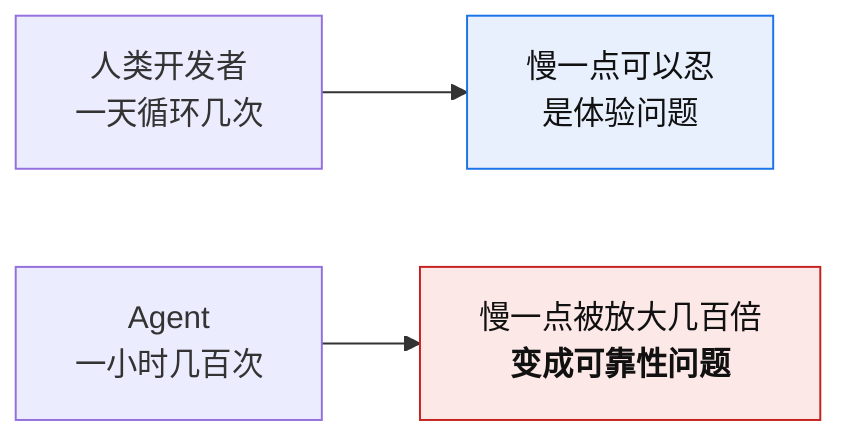
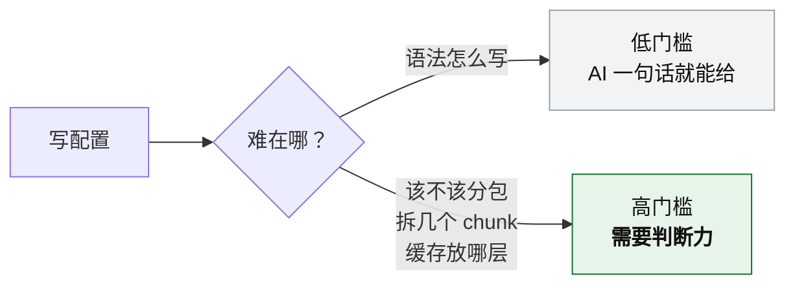

# 第 6 章 · AI 辅助构建工程

> **本章定位**：对应课程模块 3 第 5 节。
>
> **可信度提示**：本节内容在课程中已讲解，习题已作答并批改，但**学习者未做「无疑问」确认**（当时直接推进到下一节）。因此本章技术结论本身可靠（基于官方公告核验），但"学习者是否掌握"没有证据。详见 `notes/learning-progress.md`。
>
> **版本敏感提示**：本章涉及的产品状态与引用，核验日期为 2026-10-10。

**主线索**：

> **AI 辅助构建的主战场，不是"让 AI 帮你写配置"，而是"AI 成了构建工具的用户"。**

---

## 6.1 视角转换：AI 成了构建工具的用户

### 一句官方原话

Cloudflare 在 2026 年 6 月宣布 VoidZero 加入 Cloudflare 的公告里写道：

> *"Developers used to be the only users of dev servers, bundlers, linters, formatters, and CLIs. That is no longer true: agents are using them too, constantly."*
>
> （开发者曾经是 dev server、打包器、linter、formatter 和 CLI 的唯一用户。这不再成立：agent 也在用它们，而且是持续在用。）

**这句话为什么重要**：它把"AI 辅助构建"这个话题的**主语换掉了**。

- **旧框架**：AI 是一个**助手**，帮人类写配置、查文档。
- **新框架**：AI 是一个**用户**，它会直接调用 dev server、打包器、linter —— 而且频率远高于人类。

### 频率差带来的性质变化



Cloudflare 的表述是：

> *"Speed was always a developer quality-of-life improvement. **For agents, speed is a reliability requirement.**"*

**推论**：同一条"构建很慢"的事实，对人和对 agent 的性质不同。

| 对象 | "构建慢"的性质 |
|---|---|
| 人类开发者 | **体验问题** —— 等待时可以摸鱼、可以并行做别的事 |
| Agent | **可靠性问题** —— 迭代次数暴增，慢会被放大几百倍，直接影响能不能完成任务 |

**这条推论的实际含义**：它**改变的是优先级排序**，不是"该学什么新技能"。速度这件事，从"nice to have"变成了"必选项"。

### Cloudflare 列出的 agent 对工具的要求

| 要求 | 说明 |
|---|---|
| **快的构建、测试、lint / format** | 三者从"偶发检查"变成**持续护栏** |
| **清晰结构化的错误** | agent 必须**程序化读取**并据此行动 |
| **一致的 CLI** | 输出或 flag 的小不一致，会导致 agent **大幅绕路** |

**"三者成为护栏而非偶发检查"这句值得注意** —— 人类跑 lint 是提交前跑一次；agent 是每改一次都跑。**频率变了，对延迟的容忍度也变了。**

---

## 6.2 三层价值矩阵

这是本节的核心框架。

| 层次 | 痛点 | 成熟度 | 价值 |
|---|---|---|---|
| **① AI 当配置助手** | 写配置的体力活 | **成熟** | **低** —— 一锤子买卖；门槛是判断力（该不该分包）不是语法 |
| **② 构建输出对 AI 友好** | agent 读不懂 build log / 看不见浏览器 / 不知道运行时状态 / 被 CLI 不一致绊倒 | **早期，无标准** | **中高** —— **唯一需要主动决策的部分** |
| **③ AI 成为构建工具的用户** | agent 迭代次数暴增 | **已成立** | 极高，但**改变的是优先级排序，不是该学的技能** |

### 为什么层次①的价值低

**因为配置这件事的门槛从来不在语法。**



AI 能帮你写 `splitChunks` 的语法，但它不知道**你的项目该不该拆、按什么维度拆**。而后者才是真正费脑子的部分。

**结论**：让 AI 写配置是**一锤子买卖** —— 写完就不再需要。它的价值上限，就是省下查文档的那几分钟。

### 为什么层次②值得主动决策

这是三层里**唯一需要学习者主动做决定**的部分，因为：

- 它**没有标准**（早期阶段）—— 没人告诉你"正确的做法是什么"
- 它**需要你自己动手改**（不是装个插件就完事）
- 它**直接影响你未来和 AI 协作的效率**

### 为什么层次③"已成立"却不需要学新技能

因为它的结论是**排序变化**，不是**知识增加**：
- 你不需要学"专门给 AI 用的构建工具"
- 你需要知道"速度现在是硬需求"，从而在选择工具 / 配置缓存时**把这一项权重调高**

---

## 6.3 实践形态：结构化诊断与运行时感知

层次②的具体做法，目前有两种形态。

### 形态一：把构建输出变成结构化诊断

**问题**：一份完整的 build log 一次几万 token。直接塞给模型，**既贵又全是噪声**。

**做法**：把日志**预处理成结构化诊断**：

```json
{
  "file": "src/components/Chart.vue",
  "line": 42,
  "column": 8,
  "severity": "error",
  "message": "Property 'value' does not exist on type 'Props'",
  "code": "TS2339"
}
```

**三个关键设计**：

| 设计 | 效果 |
|---|---|
| **原始日志不进上下文窗口** | 只把结构化结果给模型 |
| **两步式** | `build()` 先返回紧凑摘要；需要时才 `get_errors()` 取详情 |
| **字段固定** | agent 可以程序化读取并据此行动 |

**两步式的价值**：**一次 build 可能产生几百条信息，但真正需要修的可能只有 3 条。**先给摘要，让 agent 判断要不要深入 —— 这是在不牺牲信息量的前提下省 token。

**已有实践**：`@paretools/build`、`cpp-build-mcp` 一类 MCP build server 就是这个模式。

### 形态二：让 AI 感知运行时

**问题**：**AI 看不见浏览器。** DOM、console 输出、computed style、组件树，这些都在**运行时**，源码里没有。

**做法**：以 dev server 中间件 / 浏览器代理的形式，把运行时的东西通过 **MCP** 暴露给 agent：

| 暴露的内容 |
|---|
| DOM 结构 |
| 组件树 |
| computed style |
| 编译后的模块图 |
| 路由状态 |
| 服务端日志 |

**已有实践**：Frontman、Stagewise 一类工具。

### 一个官方动作：`server.forwardConsole`

Vite 8 提供 `server.forwardConsole`：**把客户端 console 转发到终端**。

官方文档明确说明：**"在使用 AI 编码代理时尤为实用"**。

**为什么这个功能能进官方**：因为"AI 看不见浏览器"是一个**被官方承认的痛点** —— 它不再只是社区自发的补丁。

### 一个技术之外的原因：训练数据占比

**"Vite 被 agent 选中"这件事，有一条非技术的解释。**

数据点：`@cloudflare/vite-plugin` 周下载量约 **1400 万**，约为 Vite 自身安装量的 **10%**。Cloudflare 的解释是：

> **"Agent-coded applications are choosing Vite."**

Vite 胜出的原因：快、文档好、兼容广，**而且在大模型训练数据中出现得多**。

**这条呼应的是第 4 章的「默认即权力」** —— 只是从"框架的默认值"换成了"模型训练数据的默认偏好"。**当 AI 成为用户时，训练数据里的出现频率，成了一种新的默认。**

---

## 6.4 风险与边界

### 四个明确的边界

| 边界 | 说明 |
|---|---|
| **AI 看不见运行时** | DOM / console 在运行时，源码里没有 —— 需要专门暴露 |
| **AI 不理解你的业务约束** | 该不该拆包、要不要兼容旧浏览器，取决于业务，不取决于技术 |
| **结构化诊断是"有损"的** | 预处理会丢信息，需要保留取详情的通道（两步式） |
| **训练数据滞后** | 模型对新工具的认知可能落后于官方文档（这正是本章标注核验日期的原因） |

### 一条实践建议

**别把原始日志塞给 AI。** 这不是"省 token"的问题，是**信噪比**的问题 —— 几万 token 的日志里，真正有用的可能只有几行。

**正确顺序**：

```text
构建 → 结构化诊断（file/line/severity/message/code）
     → 给 AI 摘要
     → AI 判断需要详情时再取
     → 定位到具体文件的具体位置
```

---

## 6.5 本章常见误区

| # | 误区 | 正确认知 |
|---|---|---|
| 1 | 以为 AI 辅助构建 = 让 AI 写配置 | **主战场是"AI 成为构建工具的用户"** |
| 2 | 把原始 build log 整个塞给 AI | 一次几万 token，应转**结构化诊断** |
| 3 | 以为 AI 看得见浏览器 | DOM / console 在**运行时**，源码里没有 |
| 4 | 以为 AI 辅助只是"体验优化" | 对 agent，**速度是可靠性要求** |
| 5 | 以为要给 AI 专门学一套新工具 | 变的是**优先级排序**，不是知识清单 |
| 6 | 忽略 CLI 一致性 | 输出或 flag 的小不一致，会让 agent 大幅绕路 |
| 7 | 用"生态优势"解释 Vite 被 agent 选中 | 更具体、可验证的机制是**训练数据中的出现频率** |

### 一个术语澄清

课程中出现过一个典型偏差：用**短语或案例**代替**概念命名**。这里给出正确说法：

| 曾出现的说法 | 问题 | 准确的表述 |
|---|---|---|
| "生态优势" | 是标签，不是机制 | **Vite 在大模型训练数据里出现得多** → 这是一种生态位优势，但机制是"训练数据占比" |
| "TurboPack"（作为解释） | 指向了**案例**，没有命名**概念** | 正确概念是第 4 章的「**默认即权力**」（强制 = 默认 + 高摩擦回退） |

**通用规则**：回答抽象问题时，**先命名概念，再举例** —— 顺序不能反。命名之后，这句话才**可以证伪**。

---

**下一章**：[第 7 章 · 工程实践与选型](07-practice-and-selection.md) —— 把知识变成路径和决策。
