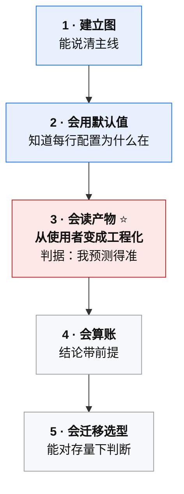
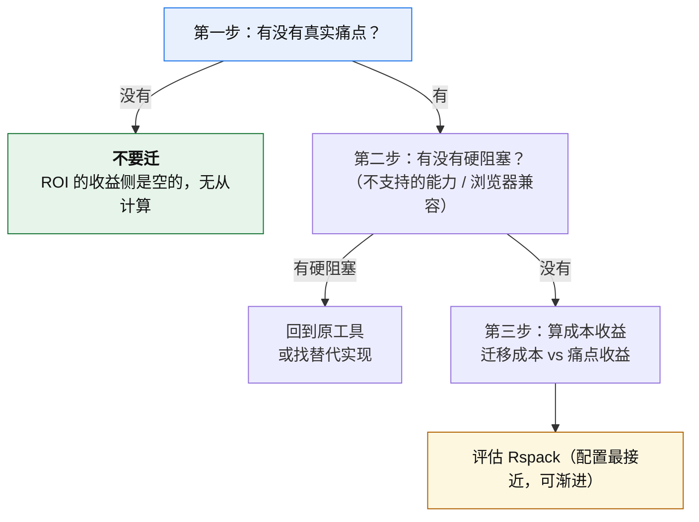

# 第 7 章 · 工程实践与选型

> **本章定位**：把前六章的知识，变成**学习路径**和**决策工具**。
>
> 对应课程：模块 4 · 学习路径（3 节）+ 模块 2 §5（选型建议）。
>
> **可信度提示**：本章的方法论经过课程讲解与互动确认，但 **§7.3 的五个动手项目，没有任何一个被实际做过**（相关习题未作答）。因此本章是"**路径建议**"而非"**路径复盘**" —— 它的价值在于**判据设计**，不在于"有人走通了"。详见 `notes/learning-progress.md`。

**主线索**：

> **按能力排，不按工具排。**
> 跟着工具换代走，每次换工具都要重学配置；按能力排，只需学一遍。

---

## 7.1 顺序按能力排，不按工具排

### 两种学习顺序

| 路线 | 顺序 | 代价 |
|---|---|---|
| **按工具排**（多数人的默认） | Webpack → Vite → Rspack → …… | **每次换工具都要重学一遍配置**，且旧知识迅速报废 |
| **按能力排** | 建立图 → 会用默认值 → 会读产物 → 会算账 → 会迁移 | 学一遍，跨工具通用 |

**为什么"按工具排"是陷阱**：因为**工具名会变，机制不会变**。

依赖图、Loader/Plugin 分工、Tree Shaking 两阶段、代码分割三策略 —— 这些在 Rspack、Rolldown、Turbopack 里**全都还在**，只是换了执行者（§4.5 的结论）。

**你花时间背的 `optimization.splitChunks` 字段默认值会过期；你理解的"为什么需要抽公共包"不会。**

---

## 7.2 五个台阶与判定标准

### 台阶表

| 台阶 | 目标 | 学什么 | **判据** | 常见跑偏 |
|---|---|---|---|---|
| **1 建立图** | 通用心智模型 | 依赖图 / Loader·Plugin / Tree Shaking / 代码分割 | 说清「源码 → 依赖图 → chunk → 产物」 | 背配置项 |
| **2 会用默认值** | 跑通真实项目 | `vite.config.ts` 最小配置、`.env` + `import.meta.env`、`build.sourcemap`、`server.proxy` | 每条配置项能说出「**为什么存在**」 | 一上手就装一堆插件 |
| **3 会读产物** ⭐ | **从使用者变成工程化** | 读 `stats` / 产物分析、chunk 划分、hash 稳定性 | **改一行代码能预测哪些产物 hash 会变；错了能解释为什么** | 只看体积，不看来源 |
| **4 会算账** | 结论站得住 | 六步测量法、三层缓存、指标拆分 | 听到「变快了」能拆出**绑定的指标与前提** | 拿厂商数字当结论 |
| **5 会迁移选型** | 对存量下判断 | 插件清单核对、产物回归对比、回退路径设计 | 给得出「**能不能迁、要多久、翻车了怎么办**」 | 先比技术优劣，不问痛点 |



### 第 3 级为什么是分水岭

**前几级的判据是「我说得清」；第 3 级的判据是「我预测得准」。**

| 级别 | 判据的性质 |
|---|---|
| 1、2 级 | **陈述性** —— 能复述、能解释 |
| **3 级** | **预测性** —— 能对未发生的事给出可验证的判断 |
| 4、5 级 | 预测性 + 决策性 |

**"改一行代码能预测哪些 hash 会变"这个判据的威力**：它一次性检验了「依赖图 + chunk 来源 + hash 计算范围 + 缓存三件套」四块知识。你预测错了，就一定有一块没真正理解。

**不读产物，所有优化都是猜的。**

### 依赖关系

- **1 → 2 → 3 必须串行**（后面的判据依赖前面的能力）。
- **4、5 可以在真实项目需求出现时再补。**
- **不要为了"学完"而学。**

---

## 7.3 每阶段的动手项目

### 配项目的两条标准

> **① 项目要小到一次做完**
> **② 必须能自证过关**（有判据，不靠感觉）

**"能自证"是更重要的那条** —— 没有判据的项目，做完也不知道自己会不会。

### 五个项目

| 台阶 | 动手项目 | 规模 | 过关判据 |
|---|---|---|---|
| 1 | **手写迷你打包器** | **≤100 行** | 跑通「两个文件互相 import」；能解释**共享模块为何只处理一次** |
| 2 | **零插件 Vite 项目** | 1 小时 | 每行配置能说出「为什么存在」；**删掉配置项目仍能跑** |
| **3** | **hash 预测游戏**（三页面项目） | 半天 | **改之前先写预测，连续 5 次正确** |
| 4 | **构建基准测量**（六步法） | 半天 | 结论**每句都带前提** |
| 5 | **迁移评估一页纸** | 半天 | 结论**含「翻车了怎么办」** |

### 每条的细节

**台阶 1 · 手写迷你打包器**

- 目的**不是**做一个能用的打包器，是**验证依赖图不是背的**。
- 最小实现：读入口 → 找 import → 递归解析 → 拼成一个函数表 → 输出一个文件。
- **判据里的"共享模块为何只处理一次"，直指 §2.1 的"图 ≠ 树"** —— 你的迷你实现必须自己处理这个去重，才能真正体会。

**台阶 2 · 零插件 Vite 项目**

- **反直觉动作：故意删掉所有配置，看还能不能跑。**
- 你会发现**大部分配置本来就不需要** —— 这正是 §3.3「Vite 默认值覆盖了语言层」的体感验证。

**台阶 3 · hash 预测游戏（本书最推荐的一项）**

- 准备一个三页面的小项目。
- 分别做四种改动，**每次改前先写下预测**（哪些产物的文件名会变），改完对照：

| 改动类型 | 预测时应考虑 |
|---|---|
| 改业务代码 | 该模块所在 chunk 变化 |
| 改依赖版本 | 相关 vendor chunk 变化 |
| 改 CSS | 样式产物 + 引用它的 chunk |
| **只改注释** | **应该什么都不变吗？** —— 如果 hash 变了，说明缓存三件套没配齐 |

- **加分项**：装 `rollup-plugin-visualizer`，看 vendor chunk 里的模块排行 —— 这一步顺手把"会读产物"练了。

**台阶 4 · 构建基准测量**

- 按 §5.6 的六步法跑一遍，产出**一段带前提的结论文字**。
- 判据不是"数据好看"，是"**每句都带前提**"。
- 实验设计见 `practice/experiments.md`。

**台阶 5 · 迁移评估一页纸**

- 五段结构：

| 段落 | 内容 |
|---|---|
| ① 依赖清单 | 现有的 loader / plugin 清单 |
| ② 硬阻塞 | 有没有用到不支持的能力 |
| ③ 产物回归方案 | 怎么证明迁移后产物没变坏 |
| ④ **回退路径** | **翻车了怎么退回去** |
| ⑤ 结论 | 能不能迁、要多久 |

- **判据是第 ④ 段** —— 没有回退路径的是**假报告**。

### 一个自检问题

**五个项目里，哪个最容易被自己"糊过去"（明面做了、实际没拿到能力）？**

**答案是台阶 2**。因为它最容易"跑起来就算完成" —— 建个项目、`npm run dev` 能开，就以为过关了。**但判据是"每行配置能说出为什么存在"+"删掉配置还能跑"** —— 加这两个判据，就是堵住糊弄的办法。

**通用规则：先写判据，再动手。**

---

## 7.4 文档与源码的阅读切入点

### 文档：用来查证，不是用来读完

**两种失败的读法**：

- 从第一页读到最后一页（读不完，且大部分用不上）
- 只搜 API（知道字段，不知道为什么）

**三种正确读法**：

| 读法 | 用法 |
|---|---|
| ① **查 API** | **只搜，不读目录** |
| ② **读机制页** | 只有少数几页值得逐字读：Webpack **Concepts**、Vite **Why Vite** 与 **Dependency Pre-Bundling**、Rollup **Plugin Development** |
| ③ **读迁移指南** ⭐ | **性价比最高** —— 写的是**官方承认的差异**，等于一份免费的对照表 |

**为什么迁移指南性价比最高**：因为它是**官方替你总结好的差异清单**。你不用自己发现"Rspack 和 Webpack 在哪些地方不一样" —— 官方文档里已经列出来了。Rspack 的 migration 页 + `rspack-compat` 仓库就是典型。

**读文档的判据**：

> **读到「已知限制 / deprecated」段落时，停下来精读。**

那是**坑的官方来源** —— 官方主动告诉你"这里有问题""这个要废弃了"，比任何第三方文章都权威。

### 源码：别从 `index.js` 读起

**三个切入点**：

| 切入点 | 门槛 | 能验证什么 |
|---|---|---|
| **① 产物反推** | **低** | 读 `dist/` 的 **runtime 胶水代码** → 直接看到**动态 import 与 HMR 的实现证据** |
| **② 插件钩子** | 中 | 挑**最熟的官方插件**，只读钩子函数体，看它接收什么、返回什么 |
| **③ 具体 bug** | 高 | 先搜**报错字符串** → 顺调用栈往回读**那一条路径** |

**为什么推荐从产物反推开始**：产物是你**自己的**代码生成的，你熟悉它应该长什么样。看到 runtime 里那段 `__webpack_require__` 的胶水代码，你能**直接对应上** §2.2 讲的"运行时胶水污染 chunkhash"。

**铁律**：

> **只读你有一个具体问题的那条路径。**
> 漫读源码是最低效的学法。

**两条纪律**：

1. **先读类型定义 / 接口描述（地图），再读实现（地形）。**
2. **读完必须留下一个可验证的结论。** 写不下「我验证了 X 是 Y」= 没读。

---

## 7.5 选型决策矩阵

> 本节是全书选型内容的**唯一决策出口**。§3.6 负责说明"为什么"，本节负责"怎么办"。

### 第一步：顺序比结论重要

> **决策顺序：先看有无迁移成本 → 再看有无硬阻塞 → 最后才比成本收益。**
> **不是先比技术优劣。**



**为什么第一步是"有没有痛点"**：

**没有痛点，ROI 的收益侧是空的** —— 你没法计算"获得了多少"，因为你没有要解决的问题。而迁移成本是实打实的（功能冻结、回归风险、CI 改造、下游产物影响）。

**关于 ROI 的实践警告**：ROI 标准在实践中很难用准 —— **收益是感受性的、隐性成本容易被低估**（功能冻结期、回归风险、CI 改造、下游依赖产物结构的人）。所以把它当**思考框架**用，别当**计算公式**用。

### 场景对照表

| 情境 | 建议 | 理由 |
|---|---|---|
| **全新项目** | **Vite** | 约定完备、冷启动快、生态成熟 |
| **中小存量项目、无硬阻塞** | **保持 Webpack** | 迁移成本 > 收益 |
| **存量项目、build 成瓶颈** | **评估 Rspack** | 配置接近 Webpack，可渐进迁移 |
| **必须深度定制产物结构** | **Rspack / Webpack** | 产物编排与干预点更强 |
| **多页 / 微前端** | 看生态，常落 Webpack / Rspack | 对插件生态与产物控制要求高 |
| **需兼容旧浏览器** | **Webpack**，或 Vite + `@vitejs/plugin-legacy` | Vite dev 依赖原生 ESM |
| **库 / 组件包** | **Vite library mode**，或 tsup / unbuild | 需求单一，够用 |

### 三条原则

1. **新项目默认 Vite**
2. **存量项目不轻易迁移**
3. **只在有明确证据「Vite 不够用」时才换**

### 组件库场景的硬坑

**这一节值得单独记，因为它的需求与"应用"完全不同。**

| 坑 | 正确做法 |
|---|---|
| Vite **默认不生成 `.d.ts`** | 用 `vite-plugin-dts`，或单独 `tsc --emitDeclarationOnly` |
| `build.lib.formats` 需**显式**声明 | 写 `['es', 'cjs']`（Vite 5 后默认只出 ESM） |
| peer 依赖被打进产物 | 必须 `rollupOptions.external` 掉（否则产物里带一份 React） |
| 入口字段没对齐 | `package.json` 的 `main` / `module` / `types` / `exports` 要**手动对齐**产物 |

**为什么"组件库选 Vite"的理由不能照抄"应用选 Vite"的理由**：

| 应用关注 | 组件库关注 |
|---|---|
| 冷启动快不快 ❌ 不相关 | **产物格式**（ESM + CJS） |
| 生态成不成熟 ⚠️ 弱相关 | **类型声明**（`.d.ts`） |
| — | **外部依赖不打包**（`external` peer） |
| — | **入口字段对齐**（`main`/`module`/`types`/`exports`） |

**组件库在 CI 里跑 build，没有 dev server** —— 所以"冷启动快"对它几乎没有意义。**这是"复用上一个场景的答案"最典型的翻车现场。**

**通用动作**：回答前先问 —— **这个场景和上一个场景，哪里不一样？**

---

## 7.6 迁移评估：一页纸模板

**判断迁移该不该做，写一页纸就够了。** 写不满一页说明想得不清楚；超过一页说明在凑字数。

```markdown
# <项目名> 构建工具迁移评估

## 1. 现状与痛点（必须有具体数字）
- 当前工具与版本：
- 生产构建耗时：___ 秒（N 次中位数，机器规格：___，代码规模：___ 行 / ___ 依赖）
- 痛点场景：CI 等待 / 本地反馈慢 / 其他

## 2. 依赖清单核对
| 现有 loader / plugin | 目标工具是否支持 | 替代方案 |
|---|---|---|
| | | |

## 3. 硬阻塞
- 浏览器兼容要求：
- 是否使用目标工具不支持的能力：
- 若有阻塞 → 结论：不迁移 / 换方案

## 4. 产物回归方案（怎么证明没变坏）
- 产物结构与体积对比方式：
- 验收判据：
- 灰度 / 双跑方式：

## 5. 回退路径（翻车了怎么办）
- 回退触发条件：
- 回退动作：
- 回退耗时：

## 6. 结论
- 能不能迁：
- 预计耗时：
- 前置条件：
```

**第 5 段是关键。** 没有回退路径的评估报告是**假报告** —— 它假设了迁移一定成功，而这在工程上不成立。

**第 1 段也必须带数字。** "构建很慢"不是痛点，"生产构建 4 分 20 秒、每次 CI 阻塞发布"才是。

---

## 7.7 本章常见误区（18 条）

| # | 误区 | 正确认知 |
|---|---|---|
| 1 | 按工具换代排学习顺序 | 按能力排，配置只学一遍 |
| 2 | 把「能跑起来」当学会了 | 判据是「**你能预测什么**」 |
| 3 | 跳过第 3 级（读产物） | **不读产物，所有优化都是猜的** |
| 4 | 第 2 级就开始装插件 | 默认值没吃透 = 不知道基线 |
| 5 | 拿厂商基准数字当自己的结论 | 厂商数字是起点，不是判据 |
| 6 | 以为五台阶必须全部走完 | 1→2→3 串行；4、5 按需补 |
| 7 | 项目做得太大 | 目的是验证概念，不是做产品 |
| 8 | 没有判据就动手 | **先写判据，再动手** |
| 9 | 台阶 1 跳过不写 | 它的价值是验证依赖图不是背的 |
| 10 | 台阶 3 只看体积数字 | **hash 变化才是因果** |
| 11 | 台阶 4 只跑一次 | 单次测的是系统负载，不是构建性能 |
| 12 | 台阶 5 写了「能迁」就收工 | 没有回退路径的是**假报告** |
| 13 | 想「把文档读完」 | 文档是**字典**，不是教材 |
| 14 | 只读 API 不读机制页 | 知道字段，不知道为什么 |
| 15 | 忽略迁移指南 | 官方承认的差异清单，白送的对照表 |
| 16 | 从 `index.js` 漫读源码 | **先有问题，再读源码** |
| 17 | 读源码不读类型定义 | **地图先于地形** |
| 18 | 读完不留可验证结论 | 写不下「我验证了 X 是 Y」= 没读 |

---

## 本书的三条带走结论

如果只记三句话，记这三句：

> **1. 默认即权力** —— 强制 = 默认 + 高摩擦回退。
>
> **2. 兼容还是另起，取决于用户有没有选择权。**
>
> **3. 知识折旧率按层排序** —— 原理层最慢、打包层最快。
> **因此第 2 章折旧最慢、回报最高。**

---

**回到开头**：[README](../README.md) · [目录](../SUMMARY.md)
