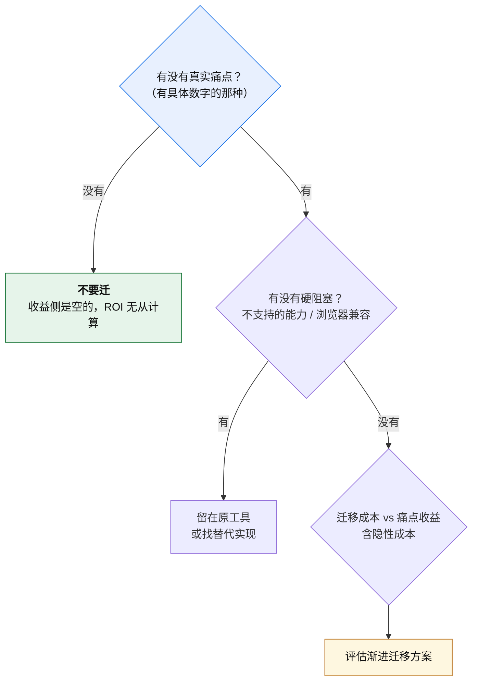

# 工具选型决策记录

> **性质**：决策工具 + 依据留档。对应第 7 章 §7.5、§7.6。
>
> **说明**：本文件记录的是**决策方法**与**已核验的事实依据**，不是"某公司选了什么"。课程中未在真实项目上做过实测，因此本文件不包含实测数据 —— 所有倍数均为厂商公开口径，见 `appendix/references.md`。

---

## 一、决策顺序（最重要的一条）

> **先看有无迁移成本 → 再看有无硬阻塞 → 最后才比成本收益。**
> **不是先比技术优劣。**



### 为什么第一步是"有没有痛点"

**没有痛点，ROI 的收益侧是空的** —— 你没法计算"获得了多少"，因为没有要解决的问题。而成本是实打实的。

### ROI 作为框架的警告

ROI 在实践中**很难用准**：

| 难点 | 说明 |
|---|---|
| 收益是感受性的 | "开发体验变好"很难折算成数字 |
| **隐性成本易低估** | 功能冻结期、回归风险、CI 改造、下游依赖产物结构的人 |

**用法**：当**思考框架**，不当**计算公式**。

### 一条追问（用于识别"假 ROI 问题"）

> **这是"划不来"的问题，还是"根本做不到"的问题？**

**示例**：问"Rspack 为什么不另造生态，兼容 Webpack 多费力？"

- 用 ROI 回答 → "再造生态成本高、ROI 低"（方向上对，量级错）
- 正确回答 → **这不是 ROI 选择，是生存条件** —— 另造生态的困境是**双边网络效应导致的冷启动起不来**（§4.3）

---

## 二、场景决策表

| 情境 | 建议 | 依据 |
|---|---|---|
| **全新项目** | **Vite** | 约定完备（默认值覆盖语言层）、冷启动快、生态成熟 |
| **中小存量项目、无硬阻塞** | **保持 Webpack** | 迁移成本 > 收益 |
| **存量项目、build 成瓶颈** | **评估 Rspack** | 配置接近 Webpack（`rspack.config.js`），可渐进迁移 |
| **必须深度定制产物结构** | **Rspack / Webpack** | 产物编排与干预点更强 |
| **多页 / 微前端** | 看生态，常落 Webpack / Rspack | 对插件生态与产物控制要求高 |
| **需兼容旧浏览器** | **Webpack**，或 Vite + `@vitejs/plugin-legacy` | Vite dev 依赖原生 ESM |
| **库 / 组件包** | **Vite library mode**，或 tsup / unbuild | 需求单一，够用 |
| **Next.js 项目** | 用默认（**Turbopack**） | 框架内置，非独立选项 |

### 三条原则

1. **新项目默认 Vite**
2. **存量项目不轻易迁移**
3. **只在有明确证据「Vite 不够用」时才换**

---

## 三、按需求维度拆解

**当上面那张表不适用时**（例如你的项目横跨多个场景），按维度拆：

| 维度 | 倾向 Webpack / Rspack | 倾向 Vite |
|---|---|---|
| 产物结构控制 | 干预点更多 | 够用但不极致 |
| 浏览器兼容 | 产物已降级，无要求 | dev 需原生 ESM |
| 插件生态 | 存量最多 | 借 Rollup 生态，够用 |
| 冷启动速度 | ∝ 项目规模 | ≈ 常数 |
| 生产构建速度 | 有持久化缓存 | Rolldown 已大幅改善 |
| 配置心智负担 | 高（两套扩展点） | 低（一套 + 大量默认值） |
| 微前端 / Module Federation | Rspack 支持 2.0 | 生态较弱 |

**注意"生产构建速度"这一行**：Vite 走 Rollup 单线程时**超大项目可能不如 Webpack**；Vite 8 换 Rolldown 后大幅改善，但**具体到你的项目仍需自测**（§5.6）。

---

## 四、已核验的事实依据

以下事实在课程中经官方来源核验（核验日期 **2026-10-10**）。**工具链演进快，使用前请复核。**

| 事实 | 值 |
|---|---|
| Rspack 兼容性 | loader runner 与 Webpack **完全兼容**；下载量 top 50 webpack 插件 **>80%** 可用或有替代 |
| Rspack 成熟度 | **1.0** 已发布，声明 production-ready；字节内部 >1000 Web 应用 |
| Rspack 不支持项 | `resolve.plugins` 等少数项 |
| Rspack 推荐 loader | `builtin:swc-loader`（减少 JS ↔ Rust 往返） |
| Farm 兼容目标 | Vite（独立项目，非字节） |
| Farm 插件机制 | `vitePlugins`；Farm JS 插件**必须配 `filters`** |
| Farm 独有策略 | Partial bundling |
| Farm 成熟度 | 2023 开源，2024–2025 生产可用；生态明显小于 Rspack |
| Turbopack 默认状态 | **Next.js 16（2025-10）** dev 与 build 双双默认 |
| Turbopack 回退 | 显式 `--webpack`；有 `webpack()` 配置则 `next build` **直接失败** |
| Turbopack 兼容性 | **完全不支持 webpack 插件** |
| Turbopack 硬要求 | Next.js —— 离开框架无意义 |
| Rolldown 兼容性 | **Rollup 插件 API 兼容** |
| Rolldown 默认状态 | Vite 8（2026-03-12）默认；Rolldown 1.0（2026-05-07） |
| Rolldown 硬约束 | Node **20.19+ / 22.12+**；**ESM-only**；**Yarn PnP 兼容问题**（Windows 尤甚） |
| Rolldown 配置变化 | `build.rollupOptions` → `build.rolldownOptions` |
| esbuild / SWC | **都不做类型检查**；只剥离类型标注 |
| SWC 插件体系 | Rust / WASM，与 Babel 的 JS 插件**不通用** |
| Vite 8 dev HMR | 相比 Vite 7 **基本没变**（收益在生产构建与依赖预构建） |
| Vite 依赖预构建执行者 | 当前为 **Rolldown**（早期为 esbuild） |

**性能数字（均为厂商公开口径，非本书实测）**：

| 工具 | 厂商口径 |
|---|---|
| Rspack | "10x faster than webpack" |
| Turbopack | 生产构建快 2–5x、Fast Refresh 快至 10x |
| Rolldown | 比 Rollup 快 10–30x，与 esbuild 持平 |
| Rolldown 案例 | Linear 46s→6s（-87%）、GitLab 2.5min→22s、Ramp -57%、Beehiiv -64%、Mercedes-Benz.io -38% |

> **使用提醒**：厂商数字是**起点**，不是**判据**。要在自己项目上用，先按 §5.6 六步法自测。

---

## 五、决策记录模板

给每个实际做过的选型决策留一份记录。

```markdown
# 决策：<项目名> 的构建工具选型

- 日期：
- 决策人：
- 状态：提议 / 已采纳 / 已废弃

## 背景
（现状用什么、痛点是什么，必须有数字）

## 候选方案
| 方案 | 优点 | 缺点 | 硬阻塞 |
|---|---|---|---|

## 决策依据
（对照第 7 章 §7.5 的决策顺序：痛点 → 硬阻塞 → 成本收益）

## 未采纳方案的原因
（这一节很重要 —— 它防止半年后有人重新提同一个方案）

## 生效条件与复查点
（什么情况下应该重新评估这个决策）
```

**"未采纳方案的原因"这一节最容易被省略，也最值钱** —— 它避免团队反复讨论同一个问题。

---

## 六、需要重新评估的信号

出现以下情况时，之前的选型决策应该被重新审视：

| 信号 | 说明 |
|---|---|
| 生产构建时间**显著增长**并开始阻塞发布 | 痛点的定义变了 |
| 出现当前工具**无法解决**的构建问题 | 硬阻塞出现了 |
| 团队**频繁**在构建配置上踩坑 | 心智负担成为真实成本 |
| 目标工具**进入默认路径**（被框架默认采用） | 学习成本大幅下降 |
| 当前工具**进入维护模式** | 长期风险 |
| 生态出现**事实标准级**的替代（如 Rolldown 进入 Vite 默认） | 迁移成本大幅下降 |

**注意最后两条**：它们说明"该不该迁"这件事**会随时间改变** —— 因为**迁移成本在变**（生态成熟度、默认路径）。所以选型决策应该带**复查点**，而不是"一次定终身"。
