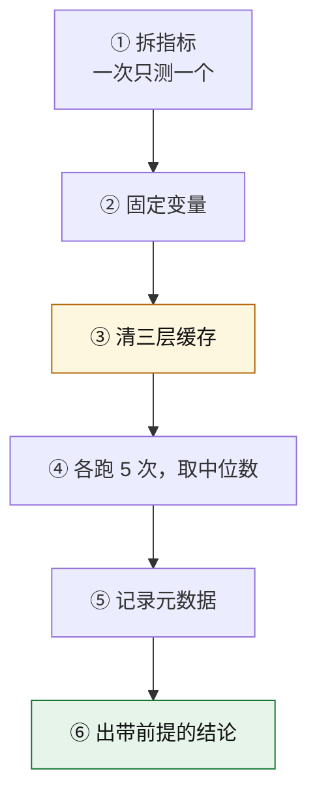

# 实验设计

基准测量与验证方法。对应第 5 章 §5.6、第 2 章 §2.2、第 7 章 §7.3。

> **本文与 `exercises.md` 的分工**：`exercises.md` 给"做什么"，本文给"怎么设计才能测出真东西"。

---

## 实验一 · 构建基准测量（六步法）

### 为什么要设计

**不做测量的优化等于没做**，而**设计错的测量比没测更糟** —— 它会给你一个看起来有据可依的错误结论。

### 步骤



### ① 拆指标

**一次只测一个。** 可选指标：

| 指标 | 测量方式 | 谁关心 |
|---|---|---|
| 冷启动 | `time npm run dev` 到出现 ready 日志 | 开发者 |
| 增量构建 | 改动一个文件 → 产物更新的耗时 | 开发者 |
| HMR 响应 | 改动一个文件 → 浏览器完成替换 | 开发者 |
| **生产构建** | `time npm run build` | CI |
| 首屏加载 | Lighthouse / Performance 面板 | 用户 |

**测了生产构建就不能同时声称"开发体验变好了"—— 那是另一个指标。**

### ② 固定变量

| 变量 | 为什么必须固定 |
|---|---|
| 机器 | 性能差异可以差几倍，会完全淹没被测对象 |
| 代码规模 | 构建耗时与模块数量强相关 |
| 依赖数量与插件数量 | 同上 |
| Node 版本 | 不同版本的解析器 / V8 性能不同 |
| 环境变量 | 例如某些 CI 标志会改变行为 |

**记录方式**：把变量写进结论里，而不是记在脑子里。

### ③ 清三层缓存

**这是最容易被省、也最致命的一步。**

| 层 | 清理方式 |
|---|---|
| 构建工具缓存 | 删 `node_modules/.cache` |
| 依赖预构建缓存（Vite） | 删 `node_modules/.vite` |
| **浏览器强缓存** | **无痕窗口**（普通窗口可能命中 disk cache） |
| 系统层 | 无法精确控制，靠多次测量摊平 |

**为什么必须清**：**`90s → 12s` 这类惊人的差异，有可能只是"首次冷构建 vs 有持久化缓存的第二次构建"的差异。** 不清缓存做的对比，测的是缓存命中率，不是构建器性能。

**一个必须做的对照实验**：

```text
第 1 轮：清缓存 → 构建 → 记录耗时
第 2 轮：不清缓存 → 构建 → 记录耗时
```

**观察两者的差异。** 这个数字会让你对"缓存"这一层有直接体感 —— 它往往比"换工具"带来的差异还大。

### ④ 各跑 5 次，取中位数

| 为什么 5 次 | 为什么中位数 |
|---|---|
| **单次测的是系统负载，不是构建性能** | 平均值受异常值（系统更新、杀毒扫描）影响；中位数更稳 |

**做法**：`for i in 1..5; do time npm run build; done`，记录 5 个数字，取中间的。

**为什么不用最小值**：最小值代表"最理想情况"，不是你日常会遇到的情况。**中位数代表典型情况。**

### ⑤ 记录元数据

**没有元数据的倍数，既无法复现，也无法对比。**

| 元数据 | 例 |
|---|---|
| 代码行数 | 约 12,000 行（含 TS / Vue） |
| 依赖数量 | 42 个 dependencies + 31 个 devDependencies |
| 插件数量 | 6 个构建插件 |
| 入口 / 路由数 | 3 个入口 |

### ⑥ 出带前提的结论

**唯一合格的产出形式。**

**模板**：

> 在 **【机器规格】** 上，对一个 **【代码规模】**、**【依赖数】**、**【插件数】** 的项目，**清空【哪些缓存】** 后，**【哪个指标】** 耗时从 **【A】** 变为 **【B】**（各跑 **【N】** 次取**中位数**）。

**自检**：把你写的结论给另一个人看，**他能不能在另一台机器上复现你的测量**？不能 → 缺前提。

---

## 实验二 · hash 预测游戏

> 这是 `exercises.md` 项目 3 的**协议说明**，玩法与判据在那里。

### 项目准备

一个三页面项目，配置里确保有：

```js
// vite.config.ts 参考
export default defineConfig({
  build: {
    rollupOptions: {
      output: {
        entryFileNames: '[name].[contenthash:8].js',
        chunkFileNames: '[name].[contenthash:8].js',
        assetFileNames: '[name].[contenthash:8][extname]',
      },
    },
  },
});
```

### 实验矩阵

| 轮次 | 改动 | 观察点 |
|---|---|---|
| 1 | 改一个页面的业务代码 | 该模块所在 chunk 是否变；其他页面是否被牵连 |
| 2 | 升一个依赖的小版本 | 该依赖所在 vendor chunk 是否变 |
| 3 | 只改一个 CSS 值 | 样式产物 + 引用它的 chunk |
| 4 | **只改一行注释** | **应该什么都不变** —— 变了说明缓存三件套没配齐 |
| 5 | 新增一个页面入口 | 模块 ID 分配是否变 → 其他产物是否被牵连 |

### 记录表模板

| 轮次 | 我的预测 | 实际结果 | 命中？ | 若未命中，根因 |
|---|---|---|---|---|
| 1 | | | | |
| 2 | | | | |
| 3 | | | | |
| 4 | | | | |
| 5 | | | | |

### 判据

**连续 5 次命中。** 未命中不是失败，**是发现了理解的缺口** —— 追根因比命中更有价值。

---

## 实验三 · 插件清单核对（迁移前）

**对应**：第 7 章 §7.3 台阶 5 的第 ② 段。

### 做法

1. 从现有配置里**导出完整的 loader / plugin 清单**。
2. 逐个对照目标工具的兼容表（例如 Rspack 的 migration 页 + `rspack-compat` 仓库）。
3. 分三类打标：

| 标记 | 含义 | 处理 |
|---|---|---|
| ✅ 直接支持 | 有等价物或直接兼容 | 无 |
| 🔄 有替代 | 功能可用别的方式实现 | 记录替代方案 |
| ❌ 无替代 | 目标工具不支持 | **判定为硬阻塞** |

### 输出

一张表：

| loader / plugin | 目标工具支持？ | 替代方案 | 影响范围 |
|---|---|---|---|
| | ✅ / 🔄 / ❌ | | |

**这张表就是迁移评估一页纸的第 ② 段。**

---

## 实验四 · 产物成分分析

**对应**：第 2 章 §2.5、第 7 章 §7.2 台阶 3。

### 要解决的问题

看到一个大 chunk（例如 1.2MB 的 `vendor.js`），**先查成分，不要先改配置**。

### 步骤


### 可用的工具

| 工具 | 适用 |
|---|---|
| `rollup-plugin-visualizer` | Vite / Rollup |
| `webpack-bundle-analyzer` | Webpack |
| `stats.json` + 自写脚本 | 需要程序化分析时 |

### 一个必须避免的动作

> **不要去"读" 1.2MB 的生产产物。**

它是**压缩混淆过的**。该读的是**构建元数据**（模块清单 + 体积 + 来源）。

### 输出

| 内容 | 例 |
|---|---|
| chunk 里体积前 3 的模块 | echarts (620KB)、moment (290KB)、lodash (71KB) |
| 它们为什么在这里 | 入口静态 import 了 echarts；moment 被 3 个页面共享所以被抽进 vendor |
| 是否在首屏路径 | 是 —— 首屏就有图表 |
| 可行动项 | echarts 改为动态 import；moment 换 dayjs |

---

## 一条贯穿全部实验的原则

> **先写判据，再动手。**
> 没有判据的实验，做完也不知道自己会不会。
